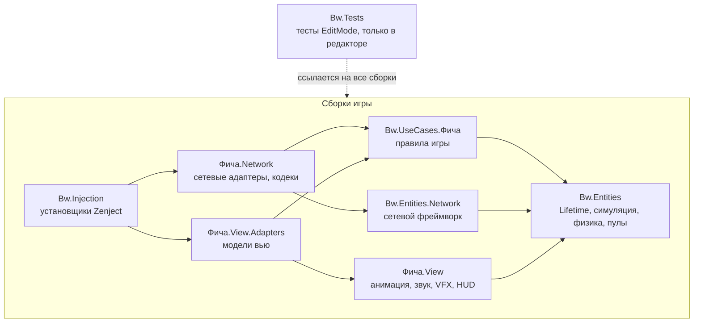
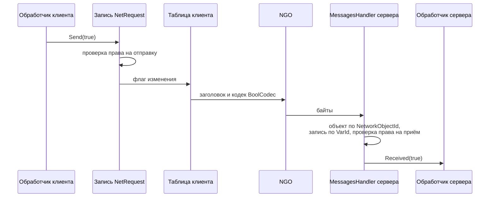
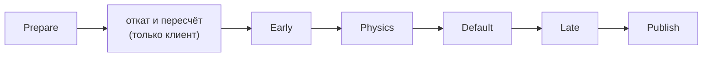
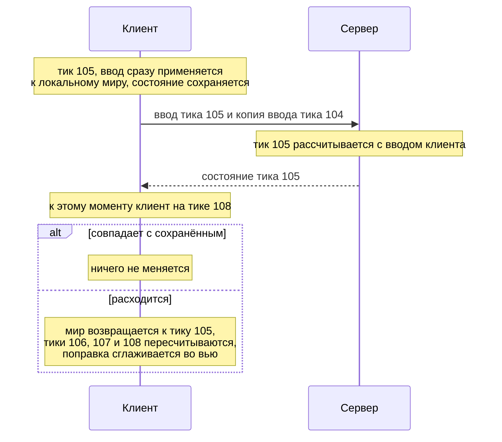
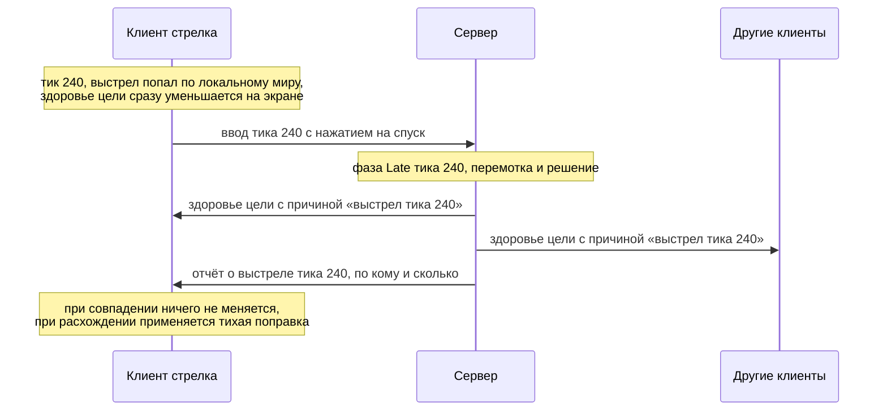
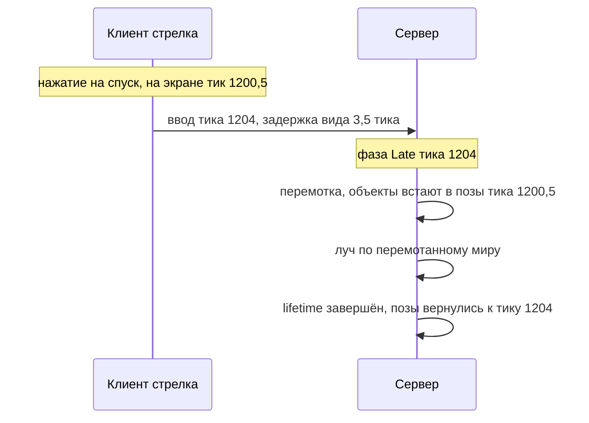
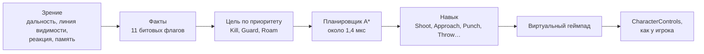

# Match, Please!

Match, Please! — сетевой 2D-шутер на Unity 6. Игроки сражаются на многоэтажных картах с лифтами и движущимися платформами: стреляют из пистолета, автомата, дробовика и снайперской винтовки, дерутся врукопашную, ставят блок, прикрываются ящиками и бросают их в противников. В матчах участвуют и боты: они играют по тем же правилам и через тот же сетевой код, что и живые игроки.

Большая часть работы над проектом ушла на сетевой код. Из Netcode for GameObjects (NGO) используются только подключение клиентов, доставка сообщений и спавн сетевых объектов, а протокол, единая шкала тиков, клиентское предсказание с откатом и лаг-компенсация написаны с нуля. В собственном протоколе ввод движения занимает 11 байт против 28 у NetworkVariable и RPC, а урон и смерти, переданные событиями, требуют в 40 раз меньше трафика, чем при потоковой репликации. Физика переведена на LowLevelPhysics2D (Box2D v3), и тик с двумя сотнями ящиков рассчитывается за 0,064 мс вместо 4,1 мс. Код проверяют больше 3000 автоматических тестов.

Автор и единственный разработчик — Андрей Панфилов.

## Содержание

- [API на примерах](#api-на-примерах)
- [Проект в цифрах](#проект-в-цифрах)
- [Архитектура](#архитектура)
  - [Сборки и зависимости](#сборки-и-зависимости)
  - [Сетевой фреймворк изнутри](#сетевой-фреймворк-изнутри)
  - [Сетевой протокол](#сетевой-протокол)
  - [Тик](#тик)
  - [Предсказание с откатом](#предсказание-с-откатом)
  - [Событийное предсказание](#событийное-предсказание)
  - [Лаг-компенсация](#лаг-компенсация)
  - [Физика](#физика)
  - [Боты](#боты)
  - [Слой отображения](#слой-отображения)
  - [Пулы](#пулы)
- [Как проверяется код](#как-проверяется-код)
- [Тесты при плохой сети](#тесты-при-плохой-сети)
- [Запуск](#запуск)
- [Структура репозитория](#структура-репозитория)
- [Стек](#стек)

## API на примерах

Ниже собраны короткие примеры работы с основными подсистемами. Код сокращён для README, но классы и методы в нём настоящие.

Почти все методы принимают `Lifetime` из библиотеки [JetBrains.Lifetimes](https://www.nuget.org/packages/JetBrains.Lifetimes). Всё, что привязано к lifetime, будь то подписка или объект из пула, живёт не дольше него и освобождается автоматически, когда lifetime завершается. Поэтому в коде игры нет ни одного вызова `Dispose`, и даже подписки на события C# снимаются при завершении lifetime.

### Взять объект из пула

Пул выдаёт объект на то время, пока жив переданный lifetime. Для эффектов, которые сами сообщают о своём окончании (интерфейс `IOneShot`), есть короткий вызов `OneShot`: объект вернётся в пул, как только эффект закончится.

```csharp
// Кровь при попадании вернётся в пул, когда эффект доиграет
_pools.For<IEffect>(bloodPrefab).OneShot(lifetime).Play(hitPoint, hitNormal);

// Трассер занят, пока летит пуля
_pools.For<IBulletTracer>(tracerPrefab).OneShot(lifetime).Fly(muzzle, hitPoint, bulletSpeed);

// Аренда на фиксированный срок: голос вернётся в пул через clip.length секунд игрового времени
var voice = _pools.For<Voice>(voicePrefab).Resource(lifetime.CreateNestedFor(clip.length));

// Сетевой ящик на сервере деспавнится и вернётся в пул при завершении crateLifetime
_pools.For<PooledNetworkObject>(cratePrefab).Spawn(crateLifetime, spot, Quaternion.identity);
```

Параметр `T` в `For<T>` задаёт тип, через который потребитель работает с объектом. Пул ищет на префабе компонент `IResource<T>`, а если такого нет, берёт компонент типа `T`. Настройки пулов хранятся в общем реестре (ScriptableObject) и описаны в разделе [«Пулы»](#пулы); вызывающий код от них не зависит.

### Подписаться, пока выполняется условие

Расширения `WhenTrue`, `WhenAlive` и подобные им открывают вложенный lifetime, который живёт, пока выполняется условие. Подписка внутри него снимается автоматически, когда условие перестаёт выполняться.

```csharp
// Пока персонаж жив, он восстанавливает здоровье каждый тик; после смерти подписка снимается сама
mortal.State.WhenAlive(lifetime, alive =>
    worldStep.Stepped(TickPhase.Default).Advise(alive, Regenerate));
```

На этом приёме построена большая часть кода. Например, клиент опрашивает клавиатуру, только пока управляет персонажем, а луч горит, пока фонарь включён и оружие в руках.

### Передать данные по сети

Для обмена данными по сети игровой код использует пять интерфейсов. Запрос идёт от клиента, который владеет объектом, к серверу. Результат идёт от сервера к одному клиенту или ко всем. Свойство хранит значение: его изменения рассылает тот, у кого есть право на запись, а новый клиент получает текущее значение при подключении.

| Интерфейс | Где используется | Что умеет |
|---|---|---|
| `INetRequestSender<T>` | на клиенте-владельце | `Send(value)` и событие `Sent` для локального предсказания |
| `INetRequestReceiver<T>` | на сервере | событие `Received` |
| `INetResultSender<T>` | на сервере | `Broadcast(value)` и `SendTo(client, value)` |
| `INetResultReceiver<T>` | на клиенте | событие `Received` |
| `INetProperty<T>` | на обеих сторонах | `Value` и подписка на изменения |

Запрос от клиента к серверу:

```csharp
// Клиент: клавиша F переключает фонарь
_toggle.Send(!flashlight.Lit.Value);

// Сервер передаёт запрос в ядро игры, которое ничего не знает о сети
_toggle.Received.Advise(lifetime, flashlight.Apply);
```

Результат от сервера одному клиенту или всем:

```csharp
// Сервер: каждому клиенту — номер его игрока, всем — запись для ленты убийств
_localPlayer.SendTo(client, ids.IdOf(player));
_kills.Broadcast(notices.Of(kill));

// Клиент
_kills.Received.Advise(lifetime, ShowKill);
```

Свойство, которое пишет сервер:

```csharp
// Сервер: фонарь включился
_lit.Value = true;

// Клиент: значение приходит при каждом изменении и сразу после подключения
_lit.Advise(lifetime, flashlight.Apply);
```

Право на запись проверяется в момент вызова. Если отправить запись не с той стороны, например запрос с клиента, который не владеет объектом, исключение возникнет сразу, до каких-либо изменений состояния.

Объекты записей создаёт и внедряет установщик сетевого объекта (Zenject Installer). Сначала он объявляет схему: список записей, одинаковый на сервере и клиенте, потому что номер записи в сообщении равен порядковому номеру её объявления.

```csharp
var toggle = netSchema.DeclareRequest<bool>(NetworkDelivery.Reliable);
var lit = netSchema.DeclareProperty(false, NetworkDelivery.Reliable, NetworkPermissions.Server);
```

Затем каждая запись привязывается к классам, которые с ней работают, и каждый класс получает только интерфейс своей роли, отправителя или получателя:

```csharp
Container.BindRequestSender(toggle).WhenInjectedInto<FlashlightClientHandler>();   // на клиенте
Container.BindRequestReceiver(toggle).WhenInjectedInto<FlashlightServerHandler>(); // на сервере
```

Что происходит между `Send` и `Received`, описано в разделе [«Сетевой фреймворк изнутри»](#сетевой-фреймворк-изнутри).

### Выполнить код в нужной фазе тика

Сетевая симуляция идёт тиками, и каждый тик разбит на фазы. Обработчик подписывается на ту фазу, в которой ему нужно работать:

```csharp
// В фазе Late все тела уже сдвинулись на этот тик, и можно проверять попадания
worldStep.Stepped(TickPhase.Late).Advise(lifetime, ResolveShots);
```

Порядок фаз и их назначение описаны в разделе [«Тик»](#тик).

### Подключить объект к предсказанию

Чтобы объект участвовал в откате, его классу в ядре достаточно отдавать текущее состояние и применять сохранённое:

```csharp
public interface IRestorable<TState> where TState : struct
{
    public IReadonlyProperty<TState> State { get; }
    public void Apply(TState state);
}
```

Установщики персонажа подключают сетевой ввод и откат двумя строками:

```csharp
PredictionInputInstaller<CharacterControls>.Install(Container, runtime, netSchema); // ввод: клиент → сервер → соседние клиенты
RollbackStateInstaller<MovementState>.Install(Container, runtime, netSchema);       // состояние: сервер → клиенты, откат
```

Всё остальное делает фреймворк. Он сохраняет состояние на каждом тике, сравнивает его с ответом сервера и при расхождении откатывает мир и пересчитывает его до текущего тика.

### Предсказать урон

Для урона используется другая, событийная модель предсказания. Цель и источник урона подключаются так:

```csharp
// Цель: любой объект со здоровьем (персонажи и ящики)
EventPredictionTargetInstaller<IReadonlyMortal, Vitals, Impacts>.Install(Container, runtime, vitals);

// Источник урона: оружие
EventPredictionInitiatorInstaller<IReadonlyWeapon, IReadonlyMortal, Impacts>.Install(Container, runtime, netSchema);
```

Клиент стрелка показывает урон сразу и ждёт решения сервера:

```csharp
_outcomePrediction.Predict(tick, target, impacts);
```

### Проверить выстрел задним числом

Объект, в который можно попасть, подключается к лаг-компенсации одной строкой, после чего сервер хранит его позы за последние тики:

```csharp
LagCompensationInstaller<RigidState, RigidPoseView>.Install(Container, runtime);
```

Сервер проверяет выстрел внутри временного lifetime. Пока этот lifetime жив, все объекты стоят в позах того тика, который видел стрелок, а когда он завершается, позы возвращаются в настоящее:

```csharp
Lifetime.Using(rewound =>
{
    _lagCompensator.Rewind(rewound, shooterView);
    tracer.CastPellets(ray, power, struck);
});
```

### Описать сетевой формат

Для каждого типа сообщения пишется кодек: структура, в которой один и тот же метод и записывает значение в буфер, и читает его оттуда.

```csharp
public struct GuardStateCodec : ICodec<GuardState>
{
    public GuardState Value { get => _value; set => _value = value; }
    private GuardState _value;

    public void NetworkSerialize<T>(BufferSerializer<T> serializer) where T : IReaderWriter
    {
        var health = Value.Health;
        var raised = Value.Raised;
        var broken = Value.Broken;
        serializer.SerializeValue(ref health);
        serializer.SerializeFlags(ref raised, ref broken); // два bool в одном байте
        Value = new GuardState(health, raised, broken);
    }
}
```

Числа с плавающей точкой передаются в квантованном виде. Точность задаётся рядом с кодеком и считается частью протокола:

```csharp
private static readonly Quantization Position = new(8); // шаг 1/256 м

serializer.SerializeQuantized(ref position, Position);  // число шагов в varint вместо 4 байт float
serializer.SerializeAngle(ref aim);                     // угол в 2 байтах
```

Код, который регистрирует кодеки в обработчике сообщений, генерирует команда редактора Tools → Network → Regenerate message codec registrations.

### Научить бота новому действию

Поведение бота складывается из GOAP-действий. Каждое действие описывает условия, результат, стоимость и навык, который его выполняет:

```csharp
// «Стрелять»: нужны видимый противник и оружие в руках, результат — противник повержен
new GoapAction(
    when: new GoapCondition(needs: BotFact.TargetInSight | BotFact.GunDrawn, forbids: BotFact.None),
    then: new GoapEffect(gives: BotFact.TargetDown, takes: BotFact.None),
    cost: bots.ShootCost,
    skill: shoot);
```

Последовательность «достать оружие, выйти на линию огня, выстрелить» планировщик строит сам из таких описаний.

### Связать вью с данными

Данные приходят во вью только через интерфейс модели. Интерфейс объявлен в той же сборке, что и вью, и все его члены доступны лишь для чтения:

```csharp
public interface IFlashlightViewModel
{
    public IReadonlyProperty<bool> Lit { get; }
}

// Луч фонаря горит, пока оружие в руках и фонарь включён
carry.Drawn.WhenTrue(lifetime, drawn =>
    flashlight.Lit.WhenTrue(drawn, lit =>
    {
        beam.Show();
        lit.OnTermination(beam.Hide);
    }));
```

## Проект в цифрах

| Показатель | Значение |
|---|---|
| Код игры | 1101 файл C#, около 38 000 строк, 45 сборок |
| Тесты | больше 3000 тестов EditMode: 428 файлов, около 38 000 строк |
| Сетевой фреймворк | 179 файлов, около 5600 строк |
| Частота тика | 30 Гц |
| Заголовок сетевого сообщения | 2–3 байта (у NetworkVariable и RPC 12–15) |
| Ввод движения | 11 байт, 330 Б/с (у NetworkVariable и RPC 28 байт, 840 Б/с) |
| Состояние движения | 22 байта (у NetworkVariable 43) |
| Урон и смерти при 8 игроках и 28 объектах | около 2 КБ/с вместо 80 КБ/с при потоковой репликации |
| Тик физики с 200 ящиками | 0,064 мс вместо 4,1 мс |
| Глубина отката | 30 тиков (1 с) |
| Окно лаг-компенсации | 0,15 с (5 тиков) |
| Боксинг в сетевом фреймворке | 0 случаев |
| Instantiate и Destroy во время стрельбы | 0 |
| Построение плана GOAP | около 1,4 мкс |
| Пройденные ботами маршруты | 997 и 995 из 1000 на двух картах |
| Слой отображения | 244 файла в 19 сборках |

## Архитектура

### Сборки и зависимости

Код игры разбит на 45 сборок (asmdef), и зависимости между ними направлены строго в одну сторону. Правила игры опираются только на базовые контракты. Сетевые адаптеры связывают правила с сетевым фреймворком, адаптеры моделей вью — с вью. Сборка `Bw.Injection` ссылается на все игровые сборки и строит из них граф объектов Zenject. Над всем этим стоит сборка тестов `Bw.Tests`: она ссылается на все сборки игры, а на неё не ссылается ни одна. Тесты собираются только в редакторе и в сборку игры не попадают.



| Сборка | Что содержит | На что не ссылается |
|---|---|---|
| `Bw.UseCases.<Фича>` | правила игры: движение, оружие, здоровье, ящики, матч, боты | сеть, вью |
| `<Фича>.Network` | обработчики запросов, рассылку состояний, кодеки | вью |
| `<Фича>.View` | анимацию, звук, VFX, HUD | ядро, сеть |
| `<Фича>.View.Adapters` | модели вью, которые читают ядро | сеть |
| `Bw.Injection` | установщики Zenject с отдельными ветками для сервера и клиента | — |
| `Bw.Tests` | модульные и интеграционные тесты, правила архитектуры и стиля кода | — |

Ядро игры одно для сервера и клиента. Стороны различаются тем, какие классы подключены к ядру в установщиках: правила попаданий и смерти работают на сервере, а предсказание — на клиенте. Само ядро не проверяет, где оно запущено, и ничего не знает о фазах тика. Если на клиенте команду ядра нужно выполнить на другом тике, например на тике интерполяции, её в нужный момент вызывает сетевой адаптер.

### Сетевой фреймворк изнутри

Сетевой фреймворк (`Bw.Entities.Network`) стоит между игровым кодом и NGO. Из NGO он использует подключение клиентов, спавн `NetworkObject` и неименованные сообщения `CustomMessagingManager`, а всё остальное реализует сам.

| Часть | Классы | Задача |
|---|---|---|
| Сетевой объект | `NetworkLifetimedBehaviour` | даёт объекту lifetime на время спавна (`SpawnedLifetime`) и его таблицу записей |
| Схема | `NetEntriesSchemaBuilder`, `NetEntriesSchema` | хранит объявления записей по порядку и считает их хеш |
| Таблица записей | `NetVariablesTableServer`, `NetVariablesTableClient` | создаёт записи по схеме, нумерует их и отправляет изменения |
| Записи | `NetRequest<T>`, `NetResult<T>`, `NetProperty<T>` | реализуют интерфейсы из раздела API |
| Права | `INetSendGuard`, `INetReceiveGuard` | решают, кто может отправить запись и от кого её можно принять |
| Кодеки | `ICodec<T>`, `MessageSender<T, TCodec>`, `MessageReceiver<T, TCodec>` | превращают значение в байты и обратно |
| Маршрутизация | `NetworkRouter`, `MessagesHandler` | передают байты в NGO и разбирают входящие сообщения |

Путь запроса от клавиши до сервера выглядит так:



Фрагменты кода ниже сокращены: проверки и тексты исключений убраны.

#### Отправка

Отправка начинается в самой записи. Метод `Send` проверяет право на отправку, запоминает значение и поднимает флаг изменения:

```csharp
public void Send(T request)
{
    Stage(NetSendTarget.Untargeted, request); // проверка права и запоминание значения
    _sent.Fire(request);                       // локальное эхо для предсказания
    Dispatch();                                // флаг изменения Dirty = true
}
```

Таблица объекта подписана на флаг каждой записи, но лишь пока этой стороне разрешено её отправлять: для запроса это время, пока клиент владеет объектом. Когда флаг поднимается, таблица сбрасывает его и отправляет запись. Отправка идёт сразу, без ожидания тика, а сообщения одного кадра NGO сам объединяет в пакеты.

```csharp
sendGuard.WhenOpen(lifetime, open =>
    entry.Dirty.AdviseTrue(open, () =>
    {
        entry.Dirty.Value = false;
        entry.Accept(this); // запись вызывает типизированный метод таблицы
    }));
```

Таблица хранит записи разных типов в одном списке и не знает их тип `T`. Чтобы не приводить значение к `object` и не упаковывать его, таблица использует двойную диспетчеризацию: запись сама вызывает обобщённый метод таблицы со своим типом, и дальше значение идёт только через обобщённые методы.

```csharp
void INetSyncVisitor.VisitSignal<T>(INetSignal<T> entry) =>
    _messageSenders.Get<T>().SendToServer(HeaderFor(entry), entry.PendingPayload, delivery);
```

Отправитель сообщений для типа `T` знает его кодек. Он заворачивает значение в кодек, а кодек и заголовок — в `NetworkMessage`. `NetworkRouter` записывает сообщение во временный буфер и передаёт его NGO:

```csharp
var message = new NetworkMessage<TCodec>(header, new TCodec { Value = payload });

using var buffer = new FastBufferWriter(Unsafe.SizeOf<TCodec>() + 16, Allocator.Temp, ushort.MaxValue);
buffer.WriteNetworkSerializable(message);
customMessaging.SendUnnamedMessage(NetworkManager.ServerClientId, buffer, delivery);
```

Пары «тип значения и его кодек» регистрирует сгенерированный код, по одной строке на кодек. Повторная регистрация того же типа значения бросает исключение.

```csharp
RegisterCodec<GuardState, GuardStateCodec>(receivers, senders);
```

Результат сервера отличается от запроса только адресатом: одному клиенту или всем. Адресат хранится в маленьком типе-объединении `NetSendTarget`, и таблица сервера выбирает ветку через статические лямбды. Состояние передаётся в лямбду кортежем, поэтому при рассылке не создаются замыкания.

```csharp
entry.PendingTarget.Switch(
    outgoing,
    untargeted: static message => message.Sender.Broadcast(message.Header, message.Payload, message.Delivery),
    targeted: static (message, client) => message.Sender.SendToClient(message.Header, message.Payload, message.Delivery, client));
```

#### Приём

На другой стороне все неименованные сообщения NGO получает `MessagesHandler`. Он читает заголовок, находит заспавненный объект и его таблицу, а таблица отдаёт запись по номеру, если отправитель имеет право в неё писать:

```csharp
reader.ReadNetworkSerializable(out NetworkMessageHeader header);
var entries = SpawnedObject(header.NetworkObjectId).NetEntries;

if (header.VarId == SchemaHashVarId)
    entries.CheckSchemaOf(senderClientId, ReadHash(reader));
else if (entries.TryGetEntryWritableBy(senderClientId, header.VarId, out var entry))
    entry.Accept(this);
```

Запись снова вызывает обобщённый метод, и получатель сообщений для её типа читает кодек и передаёт значение в запись. Для запроса и результата это событие `Received`, для свойства — новое значение `Value`.

```csharp
reader.ReadNetworkSerializable(out TCodec codec);
signal.ApplyFromNetwork(codec.Value);
```

Сообщение для объекта, которого уже нет, пропускается с предупреждением в логе. Неизвестный номер записи и запись без права бросают исключение. NGO перехватывает его, пишет в лог и отбрасывает сообщение, так что испорченный или чужой пакет не роняет сервер.

#### Права

Право на запись указывается при объявлении (`NetworkPermissions`). По нему каждая сторона выбирает проверку отправки, а сервер ещё и проверку приёма:

| Право | Отправка с клиента | Отправка с сервера | Приём на сервере |
|---|---|---|---|
| `Server`: результаты и свойства сервера | запрещена | разрешена | запрещён |
| `Client`: запросы | пока клиент владеет объектом | запрещена | только от владельца |
| `Owner` | пока эта сторона владеет объектом | пока эта сторона владеет объектом | только от владельца |
| `Everyone` | разрешена | разрешена | от любого клиента |

Запрещённая отправка никогда не проходит молча: проверка бросает исключение ещё до изменения состояния. Приём устроен так же, с одной поправкой на гонку. Если владение только что перешло к другому игроку, например после гибели персонажа, записи бывшего владельца ещё могли быть в пути, и сервер в течение секунды отбрасывает их без ошибки. Любую другую чужую запись сервер считает нарушением.

#### Схема, время жизни и поздний клиент

Таблица нумерует записи в порядке их объявления, начиная с 1. Номер 0 занят хешем схемы, который считается по FNV-1a из типов записей, способов доставки и прав.

```csharp
ushort varId = SchemaHashVarId + 1;
foreach (var declaration in schema.Declarations)
    AddEntry(lifetime, varId++, declaration, sendGuards.Create(declaration.Permissions));
```

Клиент отправляет хеш схемы при спавне каждого объекта, и сервер сразу видит клиента, у которого схема объекта отличается от серверной.

Всё, что отправляет сообщения, привязано к `SpawnedLifetime` сетевого объекта: этот lifetime начинается при спавне и завершается при деспавне. Изменения, сделанные до спавна или во время выключения NGO, не отправляются.

Таблица сервера подписана на список клиентов. Новому клиенту она сразу отправляет текущие значения всех свойств объекта с гарантированной доставкой. Запросы и результаты не повторяются: они относятся к моменту, в который были отправлены.

```csharp
clients.ByIds.View(lifetime, (_, _, client) => SendCurrentStateTo(client));
```

#### Проводная форма

Если сетевой вид значения отличается от игрового, между ними встаёт `IWireForm<TValue, TWire>`. Например, состояние рук уходит в сеть в виде `HandsSlots`, а игровой код по-прежнему работает с `HandsState`. Обёртки `WireResultSender` и `WireResultReceiver` переводят значение из одного вида в другой, и код по обе стороны о проводной форме не знает.

#### Без боксинга

Все пути отправки и приёма построены на обобщённых методах, и в IL сетевого фреймворка нет ни одной операции боксинга. Это проверяет тест `NetBoxingTests`: он читает скомпилированную сборку через Mono.Cecil и падает на любой инструкции `box`, `unbox` или `unbox.any`. Упаковка встречается и там, где этих инструкций в собственном коде нет. Сеттер `ViewableProperty<T>.Value` из JetBrains.Lifetimes сравнивает старое и новое значения через `EqualityComparer<T>.Default`, и для структуры без `IEquatable<T>` это сравнение упаковывало `MovementState` на каждом тике. Поэтому состояния, которые хранятся в реактивных свойствах, реализуют `IEquatable<T>`.

### Сетевой протокол

Каждое сообщение начинается с заголовка из двух чисел переменной длины (varint): идентификатора сетевого объекта и номера записи в его схеме. Вместе они занимают 2–3 байта.

```
┌─────────────────┬──────────────┬──────────────┐
│ NetworkObjectId │ VarId        │ данные       │
│ varint          │ varint       │ кодек записи │
│ объект          │ запись схемы │ значение     │
└─────────────────┴──────────────┴──────────────┘
```

NetworkVariable и RPC в проекте не используются по двум причинам. Во-первых, их заголовок занимает 12–15 байт, то есть в коротком сообщении он длиннее самих данных. Во-вторых, NetworkVariable не хранит номер тика, а без него состояние нельзя ни откатить, ни перемотать. Встроенного клиентского предсказания в NGO нет вовсе (оно есть только в Netcode for Entities), поэтому предсказание и откат в любом случае пришлось бы писать самостоятельно.

| Что передаётся | NetworkVariable и RPC | Match, Please! |
|---|---|---|
| заголовок сообщения | 12–15 байт | 2–3 байта |
| float | 4 байта | 1–3 байта: число шагов фиксированной точности в varint |
| угол | 4 байта | 2 байта с шагом 0,0055° |
| восемь bool | 8 байт | 1 байт |
| ввод движения | 28 байт, 840 Б/с | 11 байт, 330 Б/с |
| состояние движения | 43 байта | 22 байта |

Трафик сокращается ещё и за счёт того, что лишние данные вообще не отправляются. Необязательное поле пишется в пакет, если установлен его флаг. Например, задержка вида для лаг-компенсации передаётся лишь при нажатом спуске. Состояние ящиков, выпавшего оружия и платформ отправляется при изменении, а в покое подтверждается раз в 10 тиков. Ввод игрока сервер пересылает только тем клиентам, чьи персонажи рядом с его персонажем.

Шаги квантования — степени двойки, поэтому восстановленное значение точно представимо в формате float и при повторном квантовании даёт то же число шагов.

| Величина | Шаг квантования |
|---|---|
| позиция | 1/256 м |
| скорость, отбрасывание | 1/64 м/с |
| ось движения | 1/8; значения ±1 с клавиатуры передаются точно и занимают один байт |
| здоровье, урон | 1/32 |
| угол прицела | 360°/65 536 |

### Тик

Сервер обновляет мир 30 раз в секунду. Клиентские часы опережают серверные на время доставки ввода, чтобы ввод для тика T успевал на сервер до начала этого тика. Раз в 15 тиков сервер сообщает клиенту наименьший запас, с которым приходил его ввод, и клиент подстраивает опережение так, чтобы этот запас держался около одного тика. Опережение увеличивается быстро, а уменьшается медленно, потому что опоздавший ввод обходится дороже лишнего запаса.

Весь тик описан одним перечислением `TickPhase`, и порядок его значений совпадает с порядком выполнения. Так как сервер и клиент проходят одни и те же фазы, код, подписанный на фазу, пишется один раз и работает на обеих сторонах. Между фазами Prepare и Early клиент выполняет откат, а фазы Early, Physics, Default и Late повторяет для каждого пересчитанного тика.



| Фаза | Что выполняется | Повторяется при пересчёте |
|---|---|---|
| `Prepare` | клиент считывает свой ввод и отправляет его серверу; уточняется состав пузыря предсказания (о нём ниже); объекты вне пузыря получают состояние с сервера; боты решают, что делать | нет |
| `Early` | движущиеся объекты, например платформы, задают себе скорость на этот тик: куда их довезёт шаг физики | да |
| `Physics` | Box2D одним шагом двигает весь мир: движущиеся объекты, ящики, контакты; тела принимают позы этого тика | да |
| `Default` | шаг персонажей с вводом этого тика по миру после шага физики, отсчёт таймеров, заданных в тиках | да |
| `Late` | выстрелы, удары и броски, которым нужен готовый мир этого тика | да |
| `Publish` | рассылка состояний и ввода с сервера, запись истории поз для лаг-компенсации | нет |

### Предсказание с откатом

Без предсказания игрок видел бы реакцию на своё нажатие только после того, как ввод дойдёт до сервера и результат вернётся. При пинге 100 мс каждое движение запаздывало бы на 100 мс. Чтобы избежать этой задержки, клиент применяет свой ввод к локальной копии мира сразу и сохраняет предсказанное состояние на каждом тике. Сервер рассчитывает тот же тик с тем же вводом и присылает результат. Если результат расходится с сохранённым, клиент возвращает все предсказанные объекты к тику ответа, подставляя состояние сервера, и заново рассчитывает мир до текущего тика по записанному вводу.



Откатывается сразу весь предсказанный мир (`WorldRollback`). Каждый объект регистрирует в этом общем откате свою часть (`RollbackPart<TState>`), и при расхождении восстанавливаются все части одновременно. Пересчитывать объекты по отдельности нельзя, потому что они влияют друг на друга: персонаж толкает ящик, а брошенный ящик сбивает персонажа. Глубина отката ограничена 30 тиками (1 с). Всё, что запоминается по тикам (состояния, ввод, решённые попадания, позы для лаг-компенсации), хранится в кольцевых буферах одного типа — `TickHistory<T>`.

Клиент предсказывает «пузырь» — своего персонажа и всё в радиусе 20 м от него. Расчёт всей карты обошёлся бы дорого, а далёкие объекты на игрока всё равно не влияют. Одного своего персонажа мало, потому что толкнуть ящик или подобрать оружие игрок должен без задержки. Похожее переключение предсказания по расстоянию используется в Netcode for Entities и в Roblox.

Радиус выбран шире экрана. С учётом сдвига камеры за курсором видимая область доходит примерно до 19 м от персонажа, поэтому переход объекта между предсказанием и интерполяцией всегда происходит за краем экрана. Уровни строятся без больших открытых пространств, и этого запаса хватает.

| Объект | Как рассчитывается на клиенте |
|---|---|
| свой персонаж | по собственному вводу, без ожидания сервера |
| чужой персонаж в радиусе 20 м | по его вводу, который пересылает сервер |
| ящики и оружие в радиусе 20 м | полноценной физикой Box2D в общем откате |
| объекты дальше 24 м | интерполяцией между снимками сервера |

Границы входа и выхода разнесены: объект попадает в пузырь на расстоянии 20 м, а покидает его на 24 м. Иначе объект на границе постоянно переключался бы между предсказанием и интерполяцией.

Чужих персонажей внутри пузыря клиент рассчитывает по их собственному вводу. Получив ввод игрока, сервер в ближайшем же тике пересылает его клиентам, в чей пузырь (с запасом 6 м) попадает персонаж этого игрока, и не ждёт, пока применит ввод сам. Пока свежий ввод соседа не пришёл, клиент достраивает его по последнему известному: зажатые клавиши остаются зажатыми, а одиночные нажатия не повторяются. По тому же правилу сервер восполняет ввод клиента, если пакет потерялся. Если пришедший ввод расходится с догадкой, клиент запускает пересчёт сразу, не дожидаясь состояния от сервера.

Ввод каждого игрока вступает в силу с задержкой в один тик (33 мс), а при высоком пинге задержка растёт по правилу из Brawlhalla: до 3 тиков при 200 мс и до 4 тиков при 300 мс. За время задержки ввод успевает дойти до соседей, и каждый тик задержки на тик сокращает время, в течение которого клиенту приходится угадывать чужой ввод. При пинге 50 мс остановившийся чужой персонаж раньше проскакивал точку остановки на 1,28 м, а с задержкой и пересчётом по пришедшему вводу — на 0,43 м.

Поправку после пересчёта вью гасит постепенно, за 0,2 с. Смещение ограничивается геометрией уровня по тем же правилам, по которым мотор персонажа двигает тело, так что изображение не проходит сквозь стены и платформы. Физические тела Box2D всегда стоят в точной позиции симуляции, и сглаживание не влияет ни на попадания, ни на столкновения.

Ввод отправляется без гарантии доставки (Unreliable): потерянный пакет пересылать незачем, потому что следующий уже несёт более свежие данные. Каждый пакет содержит ввод двух тиков, текущего и предыдущего, так что одиночная потеря ничего не стоит. Нажатию на спуск присваивается номер, и даже если потеряются все пакеты с ним, первый дошедший пакет сообщит серверу номер и возраст нажатия. Если нажатие укладывается в окно лаг-компенсации, сервер засчитает выстрел задним числом, с перемоткой на момент нажатия.

У этой схемы есть цена: чужой персонаж рядом может дёрнуться, когда резко меняет направление. О смене его ввода клиент узнаёт лишь через сервер, с опозданием, и исправляет положение со сглаживанием. Для чужих персонажей нет отдельного, отстающего времени: весь мир вокруг игрока рассчитывается для одного тика, поэтому толчки и попадания между соседями согласованы.

### Событийное предсказание

Урон и смерть требуют другого подхода. Здоровье меняется редко, и передавать его каждый тик значило бы расходовать трафик впустую. Сервер отправляет новое значение здоровья только при изменении и прикладывает к нему причину, то есть объект, нанёсший удар, и тик, в котором это произошло. Решение о попадании сервер принимает один раз и больше его не пересматривает.



Каждое действие однозначно определяется парой «объект, тик» (`ActionId`), поэтому сообщения могут приходить в любом порядке, а два выстрела одного тика не путаются. Если сервер не засчитал попадание, клиент тихо возвращает здоровье цели, без вспышки и звука. При пересчёте после отката клиент повторяет решения о попаданиях, принятые при первом расчёте тика (`DecidedImpacts`). Новых решений он не принимает, и лишних попаданий не возникает.

| | Потоковая модель | Событийная модель |
|---|---|---|
| Что предсказывается | движение, оружие, ящики, руки | урон, смерть, лечение |
| Что передаётся | ввод каждый тик, состояние при изменении | одно сообщение на действие |
| Доставка | без гарантии, важен самый свежий пакет | гарантированная |
| Как исправляется ошибка | откатом и пересчётом мира | поправкой одной записи |
| Трафик здоровья при 8 игроках и 28 объектах | около 80 КБ/с | около 2 КБ/с |

### Лаг-компенсация

Стрелок видит других игроков с опозданием: на его экране они там, где были на сервере примерно половину пинга и один тик интерполяции назад. Если проверять выстрел по текущим позициям, попадание на экране превратится в промах. Чтобы этого не происходило, вместе с нажатием клиент отправляет задержку вида, то есть на сколько тиков картинка на его экране отстаёт от тика ввода, а сервер перед проверкой перематывает мир к этому моменту.



Сервер хранит позы каждого объекта по тикам и при перемотке сдвигает тела, не затрагивая состояние симуляции, так что после проверки ничего пересчитывать не нужно. Задержку вида присылает клиент, поэтому сервер ограничивает её окном в 0,15 с (5 тиков), как в Brawlhalla. Игрок с более медленной связью стреляет с упреждением.

Какие объекты стрелок видел предсказанными, сервер решает сам. Для каждого клиента он ведёт такой же пузырь, как у клиента, по своим позициям и с теми же радиусами, и запоминает, когда объект входил в пузырь и выходил из него (`BubbleHistory`). Объекты из пузыря стрелка сервер ставит в позу тика выстрела, а остальные — в позу тика интерполяции (`ShooterView.TickOf`). Отчёт о пузыре сервер от клиента не принимает, потому что такой отчёт можно подделать.

Выстрелы одного тика сервер обрабатывает в два прохода: сначала выполняет все трассировки, затем начисляет урон. Если два игрока выстрелили друг в друга в один и тот же тик, попадут оба.

### Физика

Вся физика проекта работает на LowLevelPhysics2D — низкоуровневом API Box2D v3 в Unity 6.3. Мир Box2D не обновляется сам (`SimulationType.Script`): он рассчитывается внутри тика, в фазе Physics. Так физика входит в шаг мира, и откат пересчитывает её вместе с движением персонажей.

Персонажа Box2D не двигает. Его ведёт собственный кинематический мотор: на каждом шаге мотор спрашивает мир Box2D, докуда может пройти коробка персонажа, а скорость, гравитацию и прыжок считает сам. Поэтому шаг персонажей выполняется в фазе Default, уже после шага физики, и мотор видит платформы и ящики там, где они окажутся в конце тика. В мире Box2D у персонажа есть кинематическое тело, в которое попадают пули и о которое бьются ящики.

Ниже — сравнение с прежней реализацией на классической Physics2D, где мотор опирался на `Physics2D.BoxCast`. Замеры сделаны на реальных картах при 30 Гц и 8 персонажах.

| Сцена | Мотор на Physics2D | LowLevelPhysics2D | Ускорение |
|---|---|---|---|
| «Стройка», 12 ящиков | 0,42 мс | 0,062 мс | в 6,8 раза |
| «Комбинат», 12 ящиков | 0,35 мс | 0,040 мс | в 8,8 раза |
| 100 ящиков | 2,5 мс | 0,12 мс | в 21 раз |
| «Комбинат», 200 ящиков | 4,1 мс | 0,064 мс | в 64 раза |

Box2D рассчитывает мир в вызывающем потоке (`simulationWorkers = 0`), и на небольшом мире это в 2,4 раза быстрее, чем с одним рабочим потоком.

Ящики и выпавшее оружие стали полноценными твёрдыми телами. Они вращаются и складываются в стопки, а ящик можно толкнуть на ходу или поднять и бросить. Позы тел передаёт собственный сетевой код, NetworkTransform в проекте не используется. Форма тела задаётся компонентом `BodyBox`, из которого строятся и тело Box2D, и тень для 2D-освещения; классических Collider2D на уровнях не осталось. Выстрелы, удары, подбор оружия и туман войны работают через запросы к тому же миру Box2D, а частицы эффектов сталкиваются с ним через собственный проход столкновений, повторяющий формулу встроенного модуля частиц Unity.

Симуляция Box2D детерминирована, то есть те же шаги в новом мире дают побитово тот же результат. Откату мешает только скрытое состояние контактов: снимка всего мира в LowLevelPhysics2D из Unity 6.3 нет. Из-за этого откат сохраняет и восстанавливает тела по одному, а тёплый старт контактов отключён, так как именно его импульсы оказались главным скрытым состоянием. С выключенным тёплым стартом 50 пересчётов из 58 в замере совпали с исходным расчётом бит в бит. Оставшиеся расхождения отсекаются порогами, и тело исправляется, только если отклонилось больше чем на 1 см, 1° или 0,1 м/с.

### Боты

Бот — игрок без клиента. Сервер добавляет его в матч через ту же точку входа, что и людей (`PlayerEntrance.Admit`). Разница лишь в том, кто управляет игроком (`PlayerDriver`): ботом управляет сервер, а человеком — его клиент. Мозг бота нажимает кнопки виртуального геймпада, а геймпад формирует обычный `CharacterControls`. Дальше всё как у человека: те же правила движения и стрельбы, тот же сетевой код. Ядро игры о ботах ничего не знает.



Решения бот принимает с помощью GOAP (Goal-Oriented Action Planning), подхода, впервые применённого в F.E.A.R. Обстановка описывается набором фактов: противник замечен, противник на линии огня, противник вплотную, в руках оружие, рядом есть ящик и так далее. Каждое действие указывает, какие факты ему нужны и какие запрещены, а также какие факты оно добавляет и убирает. Планировщик находит самую дешёвую цепочку действий, ведущую к цели, алгоритмом A* по наборам фактов. Чтобы добавить новое поведение, достаточно описать новое действие, а остальные действия и планировщик при этом не меняются. Мозг подключается через интерфейс `IBotBrain`, и дерево поведения или другой ИИ можно добавить как ещё одну его реализацию.

| Сложность | Что умеет | Дальность зрения | Реакция | Разброс прицела |
|---|---|---|---|---|
| Peaceful | стоит на месте, стрельба включается настройкой | 22 м | 0,6 с | ±7° |
| Light | стреляет из огнестрельного оружия | 20 м | 0,6 с | ±7° |
| Medium | как Light, а вблизи дерётся кулаками и бьёт заряженным ударом | 22 м | 0,45 с | ±4,5° |
| Hard | как Medium, а ещё прикрывается ящиками и бросает их | 26 м | 0,3 с | ±2,5° |

Каждый уровень сложности хранится в ScriptableObject с флагами умений и параметрами зрения и прицела, поэтому геймдизайнер может собрать новый уровень сложности в инспекторе, не трогая код.

Граф навигации строит настоящий мотор персонажа, запущенный в отдельном мире Box2D. Узлы расставляются через каждый метр, из каждого узла мотор пробует бег, 39 вариантов прыжка и 7 вариантов спрыгивания, и для каждой пары узлов в граф попадает самый дешёвый манёвр. Граф запекается в редакторе командой Tools → Bots → Bake Navigation, и для «Комбината» он содержит 652 узла и 6513 рёбер. A* находит путь примерно за 0,3 мс, а прыжки бот воспроизводит по записанному манёвру тик в тик. Из 1000 случайных маршрутов боты проходят 997 на одной карте и 995 на другой. Граф помечен отпечатком геометрии уровня и настроек движения, и устаревший граф сервер не примет.

### Слой отображения

Вью (анимация, звук, VFX, HUD) работает с данными через собственные интерфейсы `I…ViewModel`. Состояние приходит через `IReadonlyProperty`, события — через `ISource`, а значения, которые меняются каждый кадр, — через обычные свойства. Реализует интерфейс адаптер из отдельной сборки, и только адаптеры имеют доступ к ядру. Состояние ядра адаптер передаёт напрямую или преобразует, ничего не копируя.


Поскольку вью не видит ни ядра, ни сети, её можно запустить с вручную заполненной моделью, без игры. Именно так проверяются звуки оружия. Анимации интерфейса построены на DOTween, меню и HUD — на UI Toolkit.

### Пулы

Объект выдаётся на пересечение двух lifetime — потребителя и самого объекта — и возвращается в пул, как только завершится любой из них. Экземпляры создаются по требованию, и пул готов к работе сразу. Прогрев запускается после сборки сцены и просто заполняет запас. Такой порядок нужен для префабов, которые сами зависят от пулов, например для ящика со звуком разрушения. Если бы прогрев шёл во время сборки сцены, у таких префабов возникала бы циклическая зависимость.

| Настройка в реестре | Назначение |
|---|---|
| `Prewarm` | сколько экземпляров создаётся после сборки сцены |
| `MaxIdle` | сколько свободных экземпляров хранится после возврата |
| `InUseCap` | предел числа выданных экземпляров и поведение при его достижении: отобрать самый старый или бросить исключение; предел можно не задавать |
| `ViewOnly` | пул нужен только клиенту и на сервере не создаётся |

Сетевые объекты используют те же пулы. На сервере префаб с компонентом `PooledNetworkObject` спавнится из пула и возвращается в него при деспавне. На клиенте NGO получает экземпляры через обработчик префабов, который тоже берёт их из пула. Пулы создают объекты через контейнер Zenject, и префаб с собственным `GameObjectContext` работает из пула так же, как созданный напрямую.

## Как проверяется код

Код проверяют больше 3000 тестов EditMode в сборке `Bw.Tests` на Unity Test Framework. По объёму тесты почти равны коду игры: 428 файлов и около 38 000 строк. Модульные тесты повторяют структуру кода, а интеграционные наборы проверяют проект целиком:

| Набор | Что проверяет |
|---|---|
| `Architecture` | ядро не ссылается на сеть, вью не ссылается на ядро, в IL сетевого фреймворка нет боксинга, код следует правилам стиля |
| `Injection` | граф Zenject собирается для каждого префаба, сцены и контекста проекта, отдельно на сервере и на клиенте |
| `Netcode` | откат и пересчёт персонажа, ящика и платформы на настоящих мирах Box2D сервера и клиента |
| `Network` | реестр кодеков совпадает с выводом генератора, и у каждого типа сообщения ровно один кодек |
| `Assets` | ссылки установщиков, сетевые префабы и граф навигации ботов |

Проверки работают в GitHub Actions. CodeQL анализирует C#-код, а отдельная проверка репозитория следит, чтобы у каждого ассета был .meta-файл и GUID не повторялись. Тесты Unity запускаются на каждый пуш в master на собственном Linux-сервере в контейнерах GameCI, а по тегу версии там же собираются клиент для Windows и выделенный сервер для Linux.

## Тесты при плохой сети

Сетевое поведение проверяется в Multiplayer Play Mode с Unity Network Simulator, который добавляет клонам задержку, джиттер и потерю пакетов. Сервер ведёт по каждому объекту счётчики пропусков ввода: сколько пакетов опоздало, сколько пришло слишком рано, сколько тиков восстановлено из копии в следующем пакете и сколько заменено догадкой. Результаты за 40 секунд на объект:

| Сеть | Опоздало | Заменено догадкой | Восстановлено из копии |
|---|---|---|---|
| пинг 40 ± 20 мс, потери 1 % | 0 | 0 | 10–14 |
| пинг 150 ± 50 мс, потери 3 % | 0–2 | до 0,6 % тиков | около 100 |

Отдельный сценарий автоматически нажимал на спуск и сравнивал выстрелы клиента и сервера. Прогон шёл при прежнем окне лаг-компенсации 0,4 с:

| Условия | Засчитано сервером |
|---|---|
| потери 15 % пакетов | 12 из 12 |
| скачок задержки на 250 мс при каждом нажатии | 10 из 10 |
| пинг меняется с 20 до 110 мс | 8 из 8 |
| пинг меняется с 20 до 250 мс | 10 из 10 |
| пинг меняется с 20 до 700 мс | 6 из 8: нажатия старше окна лаг-компенсации не засчитываются |

Во всех прогонах тик выстрела в отчёте сервера совпал с тиком на клиенте, лишних выстрелов не было.

## Запуск

Для запуска нужен Unity 6000.3.11f1.

1. Откройте папку проекта в Unity Hub.
2. Откройте сцену `Assets/Resources/Scenes/GameSetupScene.unity` и нажмите Play.
3. В меню введите имя, затем создайте комнату или подключитесь по IP и порту.

Чтобы запустить несколько копий игры в одном редакторе:

1. Откройте Window → Multiplayer → Multiplayer Play Mode и включите клоны.
2. Назначьте главному редактору тег `server`, а клонам — тег `client`.
3. Чтобы добавить клону 150 мс пинга через Network Simulator, назначьте ему тег `ping150`.

Клиент для Windows и выделенный сервер для Linux собираются командами Tools → Build → Windows Client и Tools → Build → Linux Dedicated Server. В собранной игре кнопка «Создать» запускает сервер в фоновом процессе и подключает к нему текущее окно. Сервер и клиента можно запустить и из командной строки:

| Команда | Что запускается |
|---|---|
| `MatchPlease.exe -server 7777` | только сервер на порту 7777 |
| `MatchPlease.exe -room 7777` | сервер в фоновом процессе и игра в текущем окне |
| `MatchPlease.exe -connect 192.168.1.5:7777` | клиент, подключённый к указанному серверу |
| `./MatchPleaseServer.x86_64 -batchmode -nographics -server 7777` | выделенный сервер на Linux |

После изменения геометрии уровня граф навигации ботов нужно перезапечь командой Tools → Bots → Bake Navigation.

## Структура репозитория

```
.github/workflows/           CI: CodeQL, проверка репозитория, тесты Unity, сборки
Assets/
├── Game/
│   ├── Scripts/
│   │   ├── Entities/        базовые контракты: Lifetime, симуляция, физика, пулы
│   │   │   └── Network/     сетевой фреймворк: записи, тики, предсказание, откат, лаг-компенсация
│   │   ├── UseCases/        фичи: Movement, Combat, Mortality, Props, Bots, Match, Level…
│   │   ├── CoreAdapters/    каталоги персонажей и оружия
│   │   ├── Injection/       установщики Zenject
│   │   ├── Setup/           запуск и меню
│   │   └── Tests/           Bw.Tests: модульные и интеграционные тесты
│   ├── Editor/              генератор кодеков, запекание навигации, сборки, инспекторы
│   ├── Prefabs/
│   └── UI/                  UXML и USS меню и HUD
└── Resources/
    ├── Scenes/              GameSetupScene, Network, MeatPlant, ConstructionSite
    └── Setup/               настройки сети, физики и пулов
```

Все папки фич устроены одинаково:

```
UseCases/Movement/
├── Abstractions/    интерфейсы ядра
├── Extensions/      чистые функции над состояниями
├── Network/         сетевые адаптеры, кодеки, обработчики запросов
├── Physics/         мотор и коллайдер персонажа на Box2D
└── View/            вью, а в View/Adapters — модели вью
```

## Стек

| Область | Технологии |
|---|---|
| Движок | Unity 6000.3, C# 9, URP 2D, 2D Animation |
| Сеть | Netcode for GameObjects 2.9.1 как транспорт, Multiplayer Play Mode, Multiplayer Tools (Network Simulator) |
| Физика | LowLevelPhysics2D (Box2D v3) |
| Архитектура | Extenject (Zenject), JetBrains.Lifetimes, R3, UniTask |
| Интерфейс | UI Toolkit, DOTween |
| Тесты и CI | Unity Test Framework, GitHub Actions, GameCI, CodeQL |

Проект распространяется под лицензией GPL-3.0, её полный текст — в файле [LICENSE](LICENSE).
