# Match, Please!

[](https://github.com/pndte/match-please/actions/workflows/unity-tests.yml)
[](https://github.com/pndte/match-please/actions/workflows/build.yml)
[](https://github.com/pndte/match-please/actions/workflows/codeql.yml)
[](https://github.com/pndte/match-please/actions/workflows/repository.yml)
[](https://github.com/pndte/match-please/releases/latest)
[](https://pndte.itch.io/match-please?secret=lGJwzXWXsiEN7X02vTIVU1Fs)

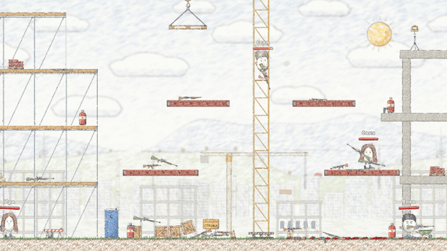

Match, Please! is an epic multiplayer 2D shooter on Unity 6. Players fight on multi-storey maps with elevators and moving platforms, shoot each other with pistols, assault rifles, shotguns and sniper rifles, brawl hand to hand and even use the environment to throw their opponents off balance!

Most of the work went into the network code. From Netcode for GameObjects (NGO) I took the bare minimum: client connections, message delivery (unnamed messages) and spawning network objects. Everything else (the protocol, one tick timeline for all peers, client-side prediction with rollback and lag compensation) is written from scratch. My framework is far cheaper on the wire than stock Unity Netcode (a movement input takes 11 bytes against 28 with NetworkVariable and RPC), and the network code runs and is tested in isolation from Unity, outside NetworkBehaviour.

If you want to go straight to the code, open [Where to look in the code](#where-to-look-in-the-code) at the end of this README. It lists the scripts every module starts from and the order to read them in.

Author and sole developer: Andrey Panfilov.

## Contents

- [Where to look in the code](#where-to-look-in-the-code)
- [API by example](#api-by-example): the network, tick phases, rollback, damage, lag compensation, wire format, subscriptions, bots, view models, [pools](#pools)
- [The project in numbers](#the-project-in-numbers)
- [Architecture](#architecture)
  - [Assemblies and dependencies](#assemblies-and-dependencies)
  - [The network framework from the inside](#the-network-framework-from-the-inside)
  - [Network protocol](#network-protocol)
  - [The tick](#the-tick)
  - [Prediction with rollback](#prediction-with-rollback)
  - [Event prediction](#event-prediction)
  - [Lag compensation](#lag-compensation)
  - [Physics](#physics)
  - [Bots](#bots)
  - [Rooms and reconnection](#rooms-and-reconnection)
- [How the code is checked](#how-the-code-is-checked)
- [CI/CD](#cicd)
- [Bad network tests](#bad-network-tests)
- [Running the game](#running-the-game)
- [Repository layout](#repository-layout)
- [Stack](#stack)

## API by example

Below are short examples of the main subsystems. The code is shortened for clarity.

First, a word about what almost all the code rests on. Sooner or later every Unity project drowns in unsubscriptions: subscribed in `OnEnable`, don't forget `OnDisable`; took an object from a pool, don't forget to return it. Miss one pair and at best memory leaks, at worst a destroyed object gets a callback and throws `MissingReferenceException`. My way out is `Lifetime` from [JetBrains.Lifetimes](https://www.nuget.org/packages/JetBrains.Lifetimes), and almost every method in the project takes one. A lifetime stands for the time while something is alive; whatever is bound to it lives no longer, and nested lifetimes end with their parent, so a dying character takes all its subscriptions with it. The game code has no `Dispose` calls at all.

### Sending data over the network

NGO offers NetworkVariable and RPC for exchanging data. Both live inside a NetworkBehaviour, so client and server code end up in one class, split by `IsServer` and `IsOwner` checks. Such a class is hard to read (which side does this method run on?) and almost impossible to test without a running network.

Look closer, and data in a networked game travels only three ways: a client asks the server to do something (a request), the server tells clients what happened (a result), and some values live on an object and must be the same for everyone (a property). I gave each way and each side its own interface, and a game class gets exactly the one it needs:

| Interface | Used on | What it does |
|---|---|---|
| `INetRequestSender<T>` | the owning client | `Send(value)` and a `Sent` event for local prediction |
| `INetRequestReceiver<T>` | the server | `Received` event |
| `INetResultSender<T>` | the server | `Broadcast(value)` and `SendTo(client, value)` |
| `INetResultReceiver<T>` | clients | `Received` event |
| `INetProperty<T>` | both sides | `Value` and change notifications |

```csharp
// Client: F toggles the flashlight
_switch.Send(!flashlight.Lit.Value);

// Server: hands the request to the game core, which knows nothing about the network
_switch.Received.Advise(lifetime, flashlight.Apply);

// Server: each client gets its own player id, everyone gets the kill feed entry
_localPlayer.SendTo(client, ids.IdOf(player));
_kills.Broadcast(notices.Of(kill));

// A property the server writes; a client gets every change and the current value on joining
_lit.Value = true;
_lit.Advise(lifetime, flashlight.Apply);
```

What if client code sends a request for an object it doesn't own? The right is checked at the call, which throws before any state changes. And how does the receiver know which entry the incoming bytes belong to? Sending the entry's name in every message is too expensive. So a network object's installer (a Zenject Installer) first declares a schema, a list of entries identical on server and client, and an entry's number in a message is its declaration index. Each entry has two ends, and handing the same entry to both classes would bring the `IsServer` mess back, so the entry is bound to each class through the interface of its role:

```csharp
var @switch = netSchema.DeclareRequest<bool>(NetworkDelivery.Reliable);
var lit = netSchema.DeclareProperty(false, NetworkDelivery.Reliable, NetworkPermissions.Server);

Container.BindRequestSender(@switch).WhenInjectedInto<FlashlightClientHandler>();   // client
Container.BindRequestReceiver(@switch).WhenInjectedInto<FlashlightServerHandler>(); // server
```

What happens between `Send` and `Received` is in [The network framework from the inside](#the-network-framework-from-the-inside).

### Tick phases

Unity doesn't define the order of `Update` across components, and for a network simulation that's a real problem. A shot has to be checked against a world where every body has already moved for this tick. If half the characters are still on the previous tick, the bullet passes through someone it hit on screen. So the simulation runs in ticks, each tick is split into phases, and a handler subscribes to the phase it needs:

```csharp
// In Late every body has moved for this tick, so hits are checked against the finished world
worldStep.Stepped(TickPhase.Late).Advise(lifetime, ResolveShots);
```

The phases are listed in [The tick](#the-tick).

### Rollback

Prediction with rollback tends to spread across the whole codebase: every object has to keep a history of its states, compare it with the server and know how to recompute itself. I wanted core classes to know nothing about it. A class only exposes its current state and applies a saved one:

```csharp
public interface IRestorable<TState> where TState : struct
{
    public IReadonlyProperty<TState> State { get; }
    public void Apply(TState state);
}
```

To repeat a character's steps, the server and nearby clients need its input, and the client needs its state rolled back. The character's installers wire both in two lines:

```csharp
PredictionInputInstaller<CharacterControls>.Install(Container, runtime, netSchema); // input: client → server → nearby clients
RollbackStateInstaller<MovementState>.Install(Container, runtime, netSchema);       // state: server → clients, rollback
```

The framework does the rest. It saves the state every tick, compares it with the server's answer and, on a mismatch, rolls the world back and replays it to the current tick.

<p align="center">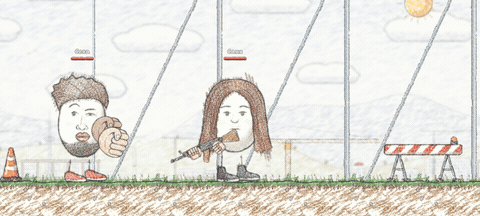<br><sub>Fists roll back with the world too: their state is a state machine of jab, charge and heavy punch phases</sub></p>

### Damage prediction

That trick doesn't work for damage. Health changes rarely, and streaming it every tick for the sake of rollback would be wasteful (see [Event prediction](#event-prediction)). Damage gets its own event-based prediction with two sides, the one who hits and the one who is hit. The shooter can't wait for the server, or every hit would lag by the ping, so the shooter's client shows the damage at once and checks it against the server's verdict later:

```csharp
EventPredictionTargetInstaller<IReadonlyMortal, Vitals, Impacts>.Install(Container, runtime, vitals);                 // anything with health
EventPredictionInitiatorInstaller<IReadonlyWeapon, IReadonlyMortal, Impacts>.Install(Container, runtime, netSchema); // a weapon

_outcomePredictor.Predict(tick, target, impacts); // the shooter's client
```

### Checking a shot in the past

The shooter always sees opponents slightly in the past, so the server has to put the world back into the moment the shooter saw. An object bullets can hit joins this with one line, and the server starts keeping its poses for the last ticks:

```csharp
LagCompensationInstaller<RigidState, RigidPoseView>.Install(Container, runtime);
```

After the check the world must return to the present. Forget it (or let the trace throw) and the next tick runs on the past world. A lifetime helps again: while it's alive, every object stands in the pose of the tick the shooter saw, and when it ends, the poses come back:

```csharp
Lifetime.Using(rewound =>
{
    _lagCompensator.Rewind(rewound, shooterView);
    shot.Tracer.CastPellets(ray, shot.Hit, struck);
});
```

### Wire format

The classic serialization bug is having separate methods for writing and reading: you add a field to one, forget the other, and the client reads garbage. My codec is a struct where one method both writes the value and reads it back. Here is the body of `TickedGuardStateCodec`:

```csharp
public void NetworkSerialize<T>(BufferSerializer<T> serializer) where T : IReaderWriter
{
    // … fields copied from Value into locals
    serializer.SerializePacked(ref tick);
    serializer.SerializeFlags(ref raised, ref broken); // two bools in one byte
    serializer.SerializeValue(ref health);
    if (raised)
        serializer.SerializeAngle(ref aim);             // the angle only for a raised guard
    // … the remaining fields, then Value is rebuilt from the locals
}
```

Floats are the next expense. A float takes 4 bytes, while a character's position needs only 1/256 m of precision, and at that precision almost any position on the map fits into 1–3 bytes. The precision of each value is declared next to its codec and is part of the protocol:

```csharp
private static readonly Quantization Position = new(8); // step 1/256 m
private static readonly Quantization Point = new(6);    // step 1/64 m

serializer.SerializeQuantized(ref position, Position);  // a varint count of steps instead of a 4-byte float
serializer.SerializeQuantized(ref aim, Point);          // the aim point in the player's input
serializer.SerializeAngle(ref angle);                   // an angle in 2 bytes
```

Every codec has to be registered in the message handler, and a forgotten registration only shows up when a message arrives and can't be read. So I don't write registrations by hand. The editor command Tools → Network → Regenerate message codec registrations generates them, and a test compares the registry with the generator's output.

<p align="center">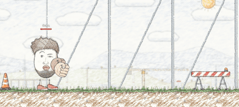<br><sub>The guard state goes through the codec above. Bullets that hit a raised guard take no health: the fighter walks into the burst and finishes the shooter with a charged punch</sub></p>

### Subscriptions that end on their own

A game has plenty of behaviour that must run while something is true. Health regenerates while the character is alive. The flashlight beam is on while the flashlight is lit and the weapon is drawn. Usually this turns into `if (_isAlive)` flags and subscribe/unsubscribe pairs scattered over `OnEnable`, `OnDisable` and death handlers. Forget one unsubscribe and a dead character keeps healing.

`WhenTrue`, `WhenAlive` and similar extensions open a nested lifetime for as long as a condition holds, and a subscription inside it ends by itself when the condition stops holding:

```csharp
// While the character is alive, regeneration runs every tick; after death the subscription is gone
mortal.State.WhenAlive(lifetime, alive =>
    worldStep.Stepped(TickPhase.Default).Advise(alive, Step));

// The beam is on while the weapon is drawn and the flashlight is lit
carry.Drawn.WhenTrue(lifetime, drawn =>
    flashlight.Lit.WhenTrue(drawn, lit =>
    {
        beam.Show();
        lit.OnTermination(beam.Hide);
    }));
```

`Step` has no "is the character alive?" check, because nobody calls it for a dead character. Most of the game code is built on this pattern.

### A new bot action

Writing bot behaviour as a tree of conditions is fun right up to the moment you want to teach the bot something new. Then you have to touch every branch where the new skill could apply. Instead, a bot's behaviour is made of GOAP actions. An action says when it's possible, what it gives, what it costs and which skill performs it:

```csharp
// "Parry": the bot is threatened and its guard is intact; the result is a parried blow
new GoapAction(
    when: new GoapCondition(needs: BotFact.Threatened | BotFact.GuardReady, forbids: BotFact.PropHeld),
    then: new GoapEffect(gives: BotFact.Parried, takes: BotFact.None),
    cost: bots.ParryCost,
    skill: guard);
```

The planner builds chains like "draw the gun, step into the line of fire, shoot" out of such descriptions. More in [Bots](#bots).

### View models

In many Unity projects views (animation, sound, effects, HUD) reach into game logic directly, and half a year later nobody can tell what changes what. I also wanted views to run without the game at all, on hand-filled data. So a view gets its data through its own read-only `I…ViewModel` interface, declared in the view's assembly, which depends on nothing else. The view assembly can't see the core, so an adapter from a separate assembly implements the interface and passes the core's state through without copying:

```csharp
public interface IFlashlightViewModel
{
    public IReadonlyProperty<bool> Lit { get; }
}

public sealed class FlashlightViewModel : IFlashlightViewModel
{
    public IReadonlyProperty<bool> Lit => _flashlight.Lit;
}
```

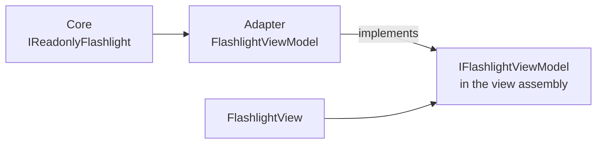

With a hand-filled model a view runs without a match; that's how I check weapon sounds. Menus and HUD use UI Toolkit, interface animations use DOTween.

### Pools

Unity's built-in `ObjectPool<T>` works like most pools: `Get` hands an object out, `Release` brings it back, and returning is the caller's job. Forget `Release` and the object is lost for good; call it twice and one object has two owners (the built-in pool catches that only in the editor); destroy the owner first and the object stays checked out forever. Wondering how to build a pool where forgetting to return an object is impossible, I arrived at this API:

```csharp
public interface IPool<out T>
{
    public T Resource(Lifetime lifetime);
}
```

There is no `Release`. The pool lends the object while the lifetime is alive and takes it back when the lifetime ends, so the caller only says how long it needs the object. NGO's prefab handler is a good example: NGO calls a pair of methods to create and destroy a network prefab instance, and the handler turns that pair into a lifetime nested in its own, so the instance returns even if `Destroy` never comes:

```csharp
var life = _lifetime.CreateNested();               // Instantiate
var networkObject = _pool.Resource(life.Lifetime); // busy while life is alive
life.Terminate();                                  // Destroy: the instance is back in the pool
```

What if the object ends before its taker? Other code may destroy it, the pool may end with the scene or reclaim the object when too many are out. So a loan lasts for the intersection of the taker's and the object's lifetimes (`Lifetime.DefineIntersection`) and ends when either does.

Next is cleanup, which differs per object: a tracer hides its lines, blood clears its particles, a sound cut off midway should fade fast or the speakers click. The taker also needs a specific type (`IBulletTracer`, `IEffect`). Only the object knows either, so the pool stores resources, and on every loan a resource gets the loan's lifetime and returns a facade of the type the taker works with:

```csharp
public interface IResource<out T>
{
    public T Facade(Lifetime lifetime);
}

// BulletTracer
public IBulletTracer Facade(Lifetime lifetime)
{
    lifetime.OnTermination(Hide); // the loan is over and the tracer lines go out
    return this;
}
```

The pool itself (`LimitedPool<T>`) knows nothing about Unity, and a resource can be a GameObject or a plain C# object. A prefab resource activates the instance for the loan (a free instance would keep rendering) and takes the facade from the instance's own `IResource<T>` component, or a `T` component if there isn't one.

Where does the taker get the right pool? A pool with its own Zenject binding per effect prefab would mean dozens of bindings, so all pools sit behind one `IPools` and are found by key at the call site; for prefabs the key is the prefab, with a short `For<T>(prefab)` extension:

```csharp
public interface IPools
{
    public IPool<T> For<T>() where T : class;               // the pool of objects of type T
    public IPool<T> For<T, TKey>(TKey key) where T : class; // a pool by key
}
```

Sizes and overflow behaviour don't belong at call sites either, so they live in a shared ScriptableObject registry: `Prewarm`, `MaxIdle`, an optional `InUseCap` that reclaims the oldest loan or throws, and `ViewOnly` for client-only pools. Instances are created through the Zenject container, so prefabs with their own `GameObjectContext` work from a pool as usual.

All this works while the taker knows how long it needs the object. Effects break that. A sound seems to last `clip.length`, but it plays at a random pitch, so it really lasts `clip.length / pitch`. Blood is particles with random lifetimes. A tracer outlives the bullet by a tail only the tracer knows. Only the object knows when it's done, so it has to say so through `IOneShot` and its single event, `ISource<Unit> Finished`. With just that event, each of the eight places that play an effect or a sound needs a nested lifetime, a loan on it and a subscription that ends it on `Finished`. That begs for an extension, and `OneShot` is it (exception handling left out):

```csharp
public static T OneShot<T>(this IPool<T> pool, Lifetime lifetime) where T : IOneShot
{
    var shot = lifetime.CreateNested();
    var facade = pool.Resource(shot.Lifetime);
    facade.Finished.Advise(shot.Lifetime, _ => shot.Terminate());
    return facade;
}

// An effect now takes one line
_pools.For<IEffect>(bloodPrefab).OneShot(_lifetime).Play(hitPoint, hitNormal);
```

The lifetime passed in is an upper bound: if the view that started the effect dies first, the effect returns unfinished. One hole remains: if the pool reclaims a loan at `InUseCap`, `Finished` never comes and the nested lifetime lives until the outer one ends, a tiny leak marked with a TODO in the code.

## The project in numbers

| Metric | Value |
|---|---|
| Game code | 1183 C# files, about 41,700 lines, 48 assemblies |
| Tests | 3218 EditMode tests: 459 files, about 41,400 lines |
| Network framework | 192 files, about 6100 lines |
| Movement input | 11 bytes, 330 B/s (28 bytes, 840 B/s with NetworkVariable and RPC) |
| Damage and deaths, 8 players and 28 objects | about 2 KB/s instead of 80 KB/s with streaming replication |
| Physics tick with 200 crates | 0.064 ms instead of 4.1 ms |
| Boxing in the network framework | none |
| Bot plan | about 9 µs for a search over 17 actions and 19 facts |
| Bot routes completed | 952 of 1000 on Construction Site, 934 of 1000 on Slaughterhouse |
| Bots in a room | up to 8, four difficulty levels, five personalities |

## Architecture

### Assemblies and dependencies

In Unity it's easy to end up with everything referencing everything, from the character script calling the network to the animation peeking into the game rules. I wanted the rules to build and test with no network and no graphics, so the code is split into 48 assemblies (asmdef) whose dependencies point strictly one way:

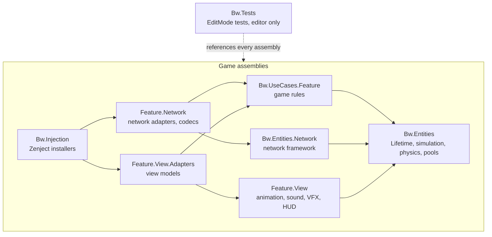

The core is the same on server and client. So what makes the sides differ? Only which classes the installers attach to it: hit and death rules run on the server, prediction runs on the client. The core never checks where it runs and knows nothing about tick phases. When a client has to run a core command on another tick (an interpolation tick, say), a network adapter calls it at the right moment.

### The network framework from the inside

In the examples above it all looks simple: `Send` on the client, `Received` on the server. You may wonder what happens between those two calls. Let's follow one key press, F for the flashlight. The framework (`Bw.Entities.Network`) takes only client connections, `NetworkObject` spawning and unnamed messages from NGO; the full list of its classes is in [Where to look in the code](#6-network-framework).

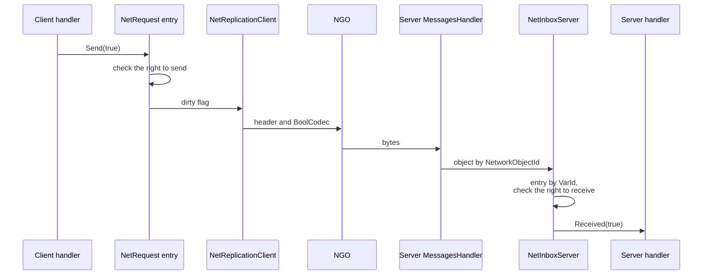

Sending, receiving and the schema check work differently on the two sides, and one class with server and client branches would carry methods that mean nothing on one of them. So each side has its own classes, `NetTablesInstaller` binds the classes of its side, and only `NetEntries`, the object's entry table, is shared. The snippets below are shortened.

#### Sending

`Send` checks the right to send, stores the value and raises a dirty flag. Why doesn't the entry send itself? It would have to know about NGO and decide whether sending is allowed yet, and on the server, as you'll see below, it isn't always. So the replication class of each side watches the flags while its side may send an entry, clears a raised flag and sends the entry right away; NGO batches the messages of one frame into packets:

```csharp
slot.SendGuard.WhenOpen(lifetime, open =>
    slot.Entry.Dirty.AdviseTrue(open, () =>
    {
        slot.Entry.Dirty.Value = false;
        slot.Entry.Accept(toServer); // the entry calls the visitor's typed method
    }));
```

Here I ran into an interesting problem. Entries of different types share one array, and the sending class doesn't know their `T`. The easy way, casting the value to `object`, would box every value on every tick. Double dispatch solved it: the entry calls the visitor's generic method with its own type, and from there the value moves only through generic methods. The visitor is a class, one per entry, because a struct called through an interface would box too:

```csharp
void INetSyncVisitor.VisitSignal<T>(INetSignal<T> signal) =>
    _senders.Get<T>().SendToServer(Header, signal.PendingPayload, delivery);
```

The sender for `T` wraps the value into its codec and the codec with a header into a `NetworkMessage`, and `NetworkRouter` hands the bytes to NGO's `SendUnnamedMessage`. A server result also has an addressee, one client or everyone. A client that is null for "everyone" would be too easy to confuse with a bug, so the addressee is a tiny union, `NetSendTarget`, switched through static lambdas so that no send allocates a closure.

#### Receiving

`MessagesHandler` gets every unnamed NGO message, reads the header, finds the spawned object and passes the message to its inbox. The client inbox simply finds the entry by number. The server can't trust clients, so its inbox first asks the receive guard whether the sender may write this entry:

```csharp
var slot = _entries.At(header.VarId);
if (_guards[slot.VarId].TryAdmit(senderClientId))
    slot.Entry.Accept(reader);
```

The entry calls a generic method again, the receiver for its type reads the codec, and a request or result fires `Received` while a property changes `Value`. A message for an object that's gone is skipped with a warning. An unknown entry number or an entry without the right throws, and NGO catches the exception, logs it and drops the message, so a bad packet can't bring the server down.

#### Rights

A hacked client could send a request for someone else's character, and a bug could make a client write a server property. So who may send what is declared with each entry (`NetworkPermissions`), and each side picks its guards by it:

| Right | Sending from a client | Sending from the server | Receiving on the server |
|---|---|---|---|
| `Server`: server results and properties | forbidden | allowed | forbidden |
| `Client`: requests | while the client owns the object | forbidden | from the owner |
| `Owner` | while this side owns the object | while this side owns the object | from the owner |
| `Everyone` | allowed | allowed | from any client; the server forwards a property to the other clients |

A forbidden send never passes silently: the guard throws before any state changes. Receiving has one allowance for a race. Right after ownership moves (when a character dies, say), the former owner's entries may still be in flight, and for one second the server drops them without an error; any other foreign entry is a violation. Bot management stands on these rights: the room's creator owns the match object, so bot orders are accepted from the creator alone.

#### Schema, lifetime and late joiners

An entry's number in a message is its index in the schema. Compact, but risky: a client of another build with entries declared in a different order would read someone else's bytes as its own and never notice. So entry 0 of every schema is the schema's hash, FNV-1a over each entry's type, delivery, right and the place it was declared, which the compiler fills in through `[CallerFilePath]` and `[CallerLineNumber]`. Swap two entries of the same type and the hash changes:

```csharp
foreach (var declaration in declarations)
{
    hash = Mix(hash, declaration.GetType().ToString());
    hash = Mix(hash, (uint)declaration.DeliveryType);
    hash = Mix(hash, (uint)declaration.Permissions);
    hash = Mix(hash, declaration.Site); // e.g. "FlashlightInstaller.cs:27"
}
```

The client sends the hash when each object spawns, and the server disconnects it through `IClientDisconnector` on a mismatch, with both hashes in the reason. A client of another build drops out on the very first object.

A message for an object the receiver doesn't have yet, or anymore, has nowhere to go, so everything that sends is bound to the object's `SpawnedLifetime`, from spawn to despawn. The server turned out to be trickier: NGO calls `OnNetworkSpawn` before it tells clients the object exists, so an entry sent then would arrive before the object. That's why `NetReplicationServer` starts sending at the first `Publish` phase after spawn, and changes made earlier wait in the flags. At despawn unsent flags are cleared, so a pooled object doesn't send signals from its previous life. A client joining mid-match never saw the earlier changes but needs every property's current value, so in the same `Publish` phase the server reliably sends each new client a snapshot of all the properties it may send.

#### No boxing

Why care about boxing this much? Every box is a heap allocation, network code runs 30 times a second for every object, and its garbage sooner or later becomes a GC pause in the middle of a firefight. So the framework has no boxing, and `NetBoxingTests` enforces it by reading the compiled assembly with Mono.Cecil and failing on any `box`, `unbox` or `unbox.any`. The sneaky part is boxing in code that has none of these instructions: the `ViewableProperty<T>.Value` setter from JetBrains.Lifetimes compares values through `EqualityComparer<T>.Default`, and for a struct without `IEquatable<T>` that quietly boxed `MovementState` on every tick. Since then every state kept in a reactive property implements `IEquatable<T>`.

### Network protocol

Why drop NetworkVariable and RPC at all? Two reasons. The first is size: their header takes 12–15 bytes, longer than the data of a typical shooter message. The second is time: a NetworkVariable keeps no tick number, and without one a state can be neither rolled back nor rewound. NGO has no client prediction anyway (Netcode for Entities does), so it had to be written regardless. My header is two varints, the network object id and the entry number, 2–3 bytes together:

```
┌─────────────────┬──────────────┬──────────────┐
│ NetworkObjectId │ VarId        │ data         │
│ varint          │ varint       │ entry codec  │
└─────────────────┴──────────────┴──────────────┘
```

| What is sent | NetworkVariable and RPC | Match, Please! |
|---|---|---|
| message header | 12–15 bytes | 2–3 bytes |
| float | 4 bytes | 1–3 bytes: a varint count of fixed-precision steps |
| angle | 4 bytes | 2 bytes, 0.0055° step |
| eight bools | 8 bytes | 1 byte |
| movement input | 28 bytes, 840 B/s | 11 bytes, 330 B/s |
| movement state | 43 bytes | 22 bytes |

More traffic is saved by not sending what isn't needed. An optional field goes into a packet only when its flag is set; crates, dropped weapons and platforms send their state on change and confirm it every 10 ticks at rest; a player's input goes only to clients whose characters are nearby. A restored value may go back onto the wire (the server forwards inputs, for instance), and if each re-quantization shifted it by a step, the error would pile up. So the quantization steps are powers of two, and a restored value quantizes back to the same number of steps: 1/256 m for positions, 1/64 m/s for velocity and knockback, 1/64 m for the aim point, 1/8 for the movement axis (keyboard ±1 is exact and takes one byte), 1/32 for health and damage and 360°/65,536 for angles.

### The tick

The server updates the world 30 times a second, and the input for tick T has to arrive before that tick starts, so the client clock runs ahead by the input's travel time. Taking the transport's RTT seemed enough, until one day on a local machine one of two clients reported an 828 ms ping while packets arrived within a couple of frames. UnityTransport updates its RTT only when a reliable packet is acknowledged, and a client that only runs and shoots sends nothing but unreliable packets, so its RTT stayed stuck on a spike from connecting. Now every 15 ticks the server tells the client the smallest margin its input arrived with, and the client steers its lead to keep that margin at about one tick. The lead grows fast and shrinks slowly, since a late input costs more than a spare tick.

A tick is split into phases whose order must be identical on server and client, or the same input produces different worlds. One enum, `TickPhase`, describes the whole tick in execution order, so code subscribed to a phase is written once and runs on both sides. Between Prepare and Early the client rolls back, and it repeats Early to Late for every replayed tick:

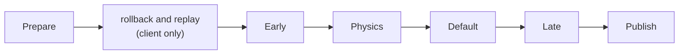

| Phase | What runs | On replay |
|---|---|---|
| `Prepare` | the client samples and sends its input; the prediction bubble is updated; objects outside it take the server's state; bots decide | no |
| `Early` | moving objects such as platforms set their velocity for the tick | yes |
| `Physics` | Box2D moves the whole world in one step | yes |
| `Default` | characters step with this tick's input; tick timers count | yes |
| `Late` | shots, punches and throws that need the finished world | yes |
| `Publish` | the server sends states and inputs and records poses for lag compensation | no |

### Prediction with rollback

Without prediction, every move would show up only after the input reached the server and the result came back, 100 ms late at 100 ms ping, and the character would feel like cotton wool. The classic fix: the client applies its input to a local copy of the world at once and saves the predicted state every tick. The server computes the same tick with the same input and sends the result. If it differs from the saved one, the client puts the server's state in at that tick and replays up to the current tick from the recorded input:

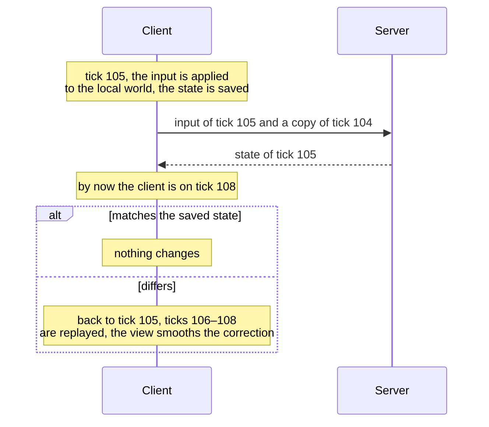

Objects affect each other (a character pushes a crate, a thrown crate knocks a character down), so they can't be replayed one by one, and the whole predicted world rolls back at once (`RollbackStepper`). Each object registers its part (`RollbackPart<TState>`), rollback goes back at most 30 ticks (1 s), and all per-tick data lives in ring buffers of one type, `TickHistory<T>`, so nothing is allocated per tick. Some events the client doesn't simulate itself, like a bot picking up a crate or a crate breaking. For those to happen on their own tick during a replay, after each replayed tick a part takes the server's state of that tick if the client already has it (`IRollbackPart.Follow`).

What to predict? Your own character isn't enough, since pushing a crate or picking up a weapon must happen without delay, and the whole map is too expensive. I settled on a bubble, much like the distance-based prediction in Netcode for Entities and Roblox: the client predicts everything within 20 m of its character (crates with full Box2D physics, other characters from their input) and interpolates the rest between server snapshots, and an object leaves the bubble only at 24 m so it doesn't flip modes on the border. The visible area reaches about 19 m, so the switch always happens off screen.

Other characters in the bubble were the most interesting part. Most shooters draw other players in the past from snapshots: exact, but in a different time from yours, so pushes and hits between neighbours stop agreeing. I decided the whole world around the player lives in one time, and other characters are computed from their own input. The server forwards a player's input on the tick it arrives to the clients whose bubble holds that character. Until a fresh input comes, the client extends the last one (held keys stay held, single presses aren't repeated), and if the real input differs from the guess, the client replays at once.

The first version forwarded inputs only after the server applied them, and even on a local machine a remote character that stopped overshot by 1.28 m and jumped back. Forwarding on arrival cut that to 0.43 m, and input delay reduces the rest: every input takes effect a tick (33 ms) later, and at high ping the delay grows by the Brawlhalla rule, up to 3 ticks at 200 ms and 4 at 300 ms. Each tick of delay is a tick less of guessing.

After a replay an object would teleport to its new position, so the view fades the correction over 0.2 s. One nasty surprise: after several corrections in a row, a remote character that landed on a girder was drawn inside it. Now the picture's offset is limited by the level geometry with the motor's own rules, while the Box2D bodies always stay at the exact simulated pose.

Input goes unreliable with two ticks per packet, so a single loss costs nothing. A click, though, lasts a tick or two, and losing exactly those packets would erase a shot the client already drew, so presses are numbered and the next packet that gets through tells the server the number and age of the press. The price of all this is that a nearby character may twitch when it turns sharply, because the client learns about the new input late.

<p align="center">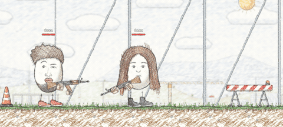<br><sub>Every hit knocks the target back. Knockback is part of the movement state and is replayed like running and jumping</sub></p>

### Event prediction

Damage and death are a different problem. Health changes rarely, sending it every tick wastes about 80 KB/s with 8 players and 28 objects, and damage is discrete: it happened or it didn't. So the server sends a new health value only when it changes, together with its cause, the object that dealt the blow and the tick. The server decides a hit once and never revisits it:

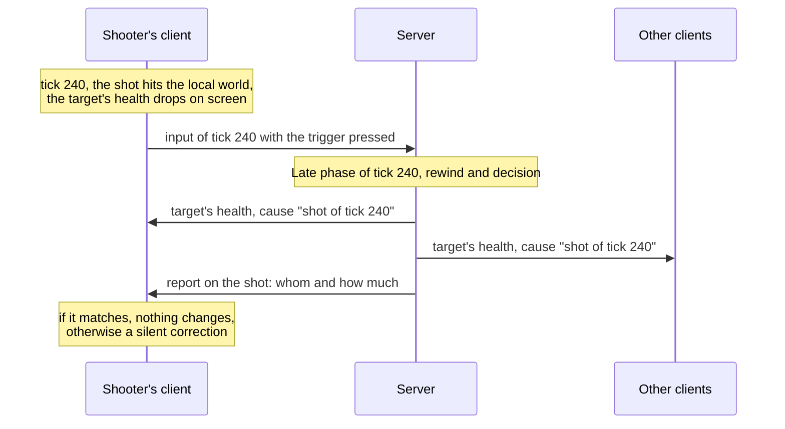

Messages arrive in any order and two barrels can fire in one tick, so every action is identified by an "object, tick" pair (`ActionId`). If the server rejects a hit, the client silently restores the target's health, with no flash and no sound. A replay must not decide hits anew, or one hit would count twice, so it repeats the decisions made the first time (`DecidedImpacts`). Health traffic drops from about 80 KB/s to about 2 KB/s.

### Lag compensation

Picture it: you aim, pull the trigger, watch the bullet hit your opponent's head, and the server says "miss". Annoying? Very. The shooter sees other players about half a ping and one interpolation tick in the past, so checking against current positions turns hits into misses. How do you fix it? The client sends its view delay with the press, and the server rewinds the world to that moment before checking:

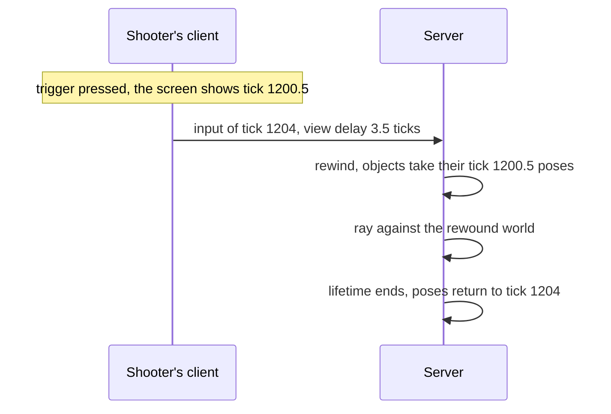

The server moves only bodies when rewinding, so nothing has to be recomputed afterwards. A client can't be trusted with its view delay (a made-up one-second delay would hit people who hid long ago), so the server caps it at 0.15 s, as Brawlhalla does. The bubble adds a subtlety: the shooter saw objects in its bubble in the present and the rest in the past. The server keeps the same bubble for each client from its own positions and remembers who was in it (`BubbleHistory`) instead of trusting a client report, which is easy to forge.

If the aim were an angle, a running shooter's bullet would miss the cursor, because on the shot's tick the hands are somewhere else. So the input carries the aim as a point on the map, and each side computes the angle from the hands of that tick. One tick's shots are handled in two passes, traces first and damage second, so two players who shoot each other on the same tick both hit.

<p align="center">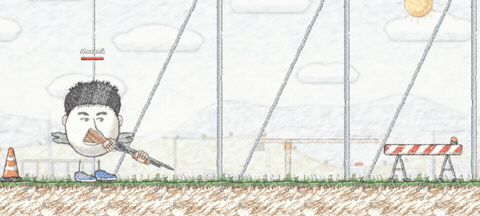<br><sub>Every pellet is traced separately, and damage and knockback on one target add up</sub></p>

### Physics

At first the character moved on classic Physics2D with `Physics2D.BoxCast`. It worked until I checked lots of crates: with two hundred, a physics tick took 4.1 ms, and a client replays several ticks per frame. Unity 6.3 brought LowLevelPhysics2D, a low-level API for Box2D v3, and I moved all physics to it. The world is stepped manually inside the tick, in the Physics phase, so rollback replays physics with movement. Box2D doesn't move characters: my kinematic motor asks the world how far the character's box can go and computes velocity, gravity and jumps itself. Measured on the real maps at 30 Hz with 8 characters:

| Scene | Motor on Physics2D | LowLevelPhysics2D | Speed-up |
|---|---|---|---|
| Construction Site, 12 crates | 0.42 ms | 0.062 ms | 6.8× |
| Slaughterhouse, 12 crates | 0.35 ms | 0.040 ms | 8.8× |
| 100 crates | 2.5 ms | 0.12 ms | 21× |
| Slaughterhouse, 200 crates | 4.1 ms | 0.064 ms | 64× |

<p align="center">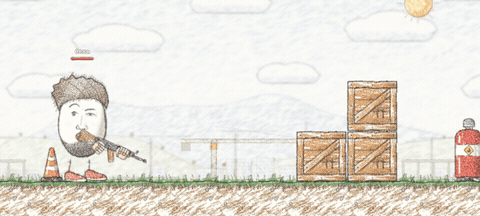<br><sub>Bullets push and split crates, and the stack collapses once the bottom crate breaks</sub></p>

Crates and dropped weapons are full rigid bodies that can be pushed, picked up and thrown, with their poses sent by my own network code. A body's shape is needed by both the Box2D body and the 2D lighting shadow, so one `BodyBox` component builds both, and the levels have no classic Collider2D left. Since the built-in particle module collides only with classic physics, effect particles collide with the Box2D world through my own collision pass.

That left rollback. Box2D is deterministic, but LowLevelPhysics2D in Unity 6.3 has no snapshot of the whole world, and contacts carry hidden state. I save and restore bodies one by one with contact warm starting off, since its impulses turned out to be the main hidden state. With it off, 50 of 58 replays in a test matched the original bit for bit, and the rest are cut by thresholds of 1 cm, 1° and 0.1 m/s.

### Bots

For bots I set one hard rule: a bot plays by the same rules as a human. No coordinates through walls, no special paths in the core. A bot is a player without a client, admitted through the same entry point (`PlayerAdmitter.Admit`) and driven by the server instead of a client (`PlayerDriver`). Its brain presses buttons on a virtual gamepad that produces an ordinary `CharacterControls`, and from there it's the same rules and the same network code. A fun side effect: the clip at the top was shot with six bots whose gamepads were pressed by a filming script.

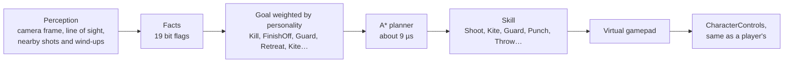

A bot sees what a player in its place would, a 26 × 14.6 m camera frame minus whatever walls hide, hears shots passing within 1.5 m and notices wind-ups within 3.5 m. A behaviour tree for a bot that shoots, brawls, guards, throws crates and retreats would grow into a web of conditions, so decisions are made by GOAP (Goal-Oriented Action Planning), first used in F.E.A.R. The situation is 19 facts, each action lists the facts it needs, forbids, adds and removes, and an A* planner finds the cheapest chain of actions to a goal in about 9 µs over 17 actions. The brain sits behind `IBotBrain`, so a behaviour tree could replace GOAP as one more implementation.

A bot has seven goals: Kill, FinishOff, PunishReload, Guard, Retreat, Kite and Roam. Bots that weighed them the same way would all play the same, so each goal's urgency is multiplied by a weight from the bot's personality, and a new goal wins only by a margin of 0.25 so the bot doesn't flip between two close ones.

| Difficulty | What it does | Reaction | Aim spread |
|---|---|---|---|
| Peaceful | stands still and doesn't shoot | 0.6 s | ±7° |
| Light | walks the map and shoots | 0.6 s | ±7° |
| Medium | as Light, plus fists, charged punches and parrying | 0.45 s | ±4.5° |
| Hard | as Medium, plus hiding behind crates and throwing them | 0.3 s | ±2.5° |

| Personality | What sets it apart | Retreats at health |
|---|---|---|
| Berserker | the keenest to finish off and brawl, reluctant to take crates | 15 % |
| Hunter | finishes off the wounded first | 30 % |
| Cautious | guards and retreats behind a crate more than anyone | 55 % |
| Evasive | keeps 7–12 m away and punishes reloads | 40 % |
| Marksman | prefers shooting and avoids fist fights | 40 % |

The navigation graph is the part I'm most proud of. A NavMesh knows nothing about platformer jumps, and hand-placed links lie about where a character can really jump, so bots get stuck. My graph is built by the real character motor in a separate Box2D world: from every node, a metre apart, it tries running, 39 jumps and 7 drop-downs, and the cheapest manoeuvre between each pair of nodes goes into the graph (652 nodes and 6513 edges on Slaughterhouse). Bots replay jumps tick by tick and complete 952 of 1000 random routes on Construction Site and 934 on Slaughterhouse. The graph carries a fingerprint of the level and movement settings, so the server rejects a stale one.

### Rooms and reconnection

My architecture has no host mode where one window is both server and client: the side is chosen once per session. So a room is held by a background server. "Create" launches the game's own build with `-server`, `-level`, `-host-key` and `-bots`, and the current window connects to it as a client.

Joining a room is a small chicken-and-egg problem: a client needs the map scene to enter the match but learns the map only by connecting. So the first connection carries a map request, the server rejects it with the scene name in the reason, and the client loads that scene and connects again. To tell its creator from other clients, the room gets a secret host key at launch; the creator sends the same key and becomes the owner of the match object, so only the creator can manage bots (see [Rights](#rights)).

What if a player's connection drops mid-match? Each client sends its token (a Guid) when connecting. When it disconnects, the player stays in the match and a Light, Cautious stand-in bot drives the character until a client with the same token takes the player back.

## How the code is checked

The project has almost as much test code as game code: 3218 EditMode tests in the `Bw.Tests` assembly on the Unity Test Framework, 459 files and about 41,400 lines. Unit tests mirror the code structure, and integration suites check the project as a whole:

| Suite | What it checks |
|---|---|
| `Architecture` | the core doesn't reference the network, views don't reference the core, the network framework's IL has no boxing, the code follows the style rules |
| `Injection` | the Zenject graph builds for every prefab, scene and the project context, separately on server and client |
| `Netcode` | rollback and replay of a character, a crate and a platform in real server and client Box2D worlds |
| `Network` | the codec registry matches the generator's output, and every message type has exactly one codec |
| `Assets` | installer references, network prefabs and the bots' navigation graph |

The tests run in GitHub Actions on every push to master, and a release is built only from code that passed them.

## CI/CD

All automation runs on free GitHub runners (`ubuntu-latest`). Unity runs in [GameCI](https://game.ci) Docker containers (`unity-test-runner` and `unity-builder`), and the Unity Personal license is kept in repository secrets.

| Workflow | Runs on | What it does |
|---|---|---|
| `codeql.yml` | push and pull request to master, weekly | CodeQL static analysis of C# with the security-and-quality rule set |
| `repository.yml` | push and pull request | every asset has a .meta file and every .meta file has an asset, GUIDs are unique, Library, Temp, Logs and UserSettings aren't in git |
| `unity-tests.yml` | push to master, manual | all EditMode tests of `Bw.Tests` |
| `build.yml` | `v*` tag, manual | the same tests, then client and server builds, the server Docker image and a release |
| `itch.yml` | after a stable release, manual | uploads the Windows client from the GitHub Release to itch.io with butler |

The tests take about 14 seconds and the whole job 7–9 minutes, with the Library folder cached by `actions/cache`. Pull requests from forks get no Unity license secrets, so tests don't run on them. A release is made with a version tag:

```bash
git tag -a v0.2.0 -m "Match Please 0.2.0"
git push origin v0.2.0
```

On a tag, `build.yml` runs the tests and, if they pass, builds the Windows client (StandaloneWindows64, Mono) and the Linux dedicated server with the editor script `GameBuilder` (Tools → Build). The server goes into an Ubuntu 24.04 Docker image (an unprivileged user, UDP port 7777), which the workflow starts and requires to run for 15 seconds without exceptions before pushing it to GitHub Container Registry. GitHub Releases gets both archives and `SHA256SUMS.txt`, a tag with a hyphen (`v0.2.0-beta.1`) becomes a pre-release, and a stable client goes on to [itch.io](https://pndte.itch.io/match-please?secret=lGJwzXWXsiEN7X02vTIVU1Fs) through butler. A release takes about 20 minutes; the current version is [v0.1.2](https://github.com/pndte/match-please/releases/tag/v0.1.2), and Dependabot updates the action versions weekly.

The server image is public (about 120 MB compressed) and starts with one command; another port is passed as an argument:

```bash
docker run -d -p 7777:7777/udp ghcr.io/pndte/match-please-server:0.1.2
docker run -d -p 7800:7800/udp ghcr.io/pndte/match-please-server:0.1.2 -server 7800
```

## Bad network tests

Network code is easy to write so that everything is perfect on a local machine and falls apart on the real internet. So I run the game in Multiplayer Play Mode with Unity Network Simulator, which adds latency, jitter and packet loss to the clones. The server counts input gaps per object: packets that came late, packets that came too early, ticks restored from the copy in the next packet and ticks replaced by a guess. Results per object over 40 seconds:

| Network | Late | Guessed | Restored from the copy |
|---|---|---|---|
| ping 40 ± 20 ms, 1 % loss | 0 | 0 | 10–14 |
| ping 150 ± 50 ms, 3 % loss | 0–2 | up to 0.6 % of ticks | about 100 |

A separate script pulled the trigger automatically and compared client and server shots (with the earlier 0.4 s lag compensation window). The server counted 12 of 12 shots at 15 % loss, 10 of 10 with a 250 ms spike on every press and every shot with ping jumping from 20 to 110 or 250 ms; at 700 ms it counted 6 of 8, because older presses fall outside the window. The shot tick always matched the client's, and there were no extra shots.

## Running the game

The easiest way is to download the game from [its itch.io page](https://pndte.itch.io/match-please?secret=lGJwzXWXsiEN7X02vTIVU1Fs). Builds of the Windows client and the Linux server are also in [GitHub Releases](https://github.com/pndte/match-please/releases), and the server is available as a Docker image (see [CI/CD](#cicd)).

Running from source requires Unity 6000.3.11f1.

1. Open the project folder in Unity Hub.
2. Open `Assets/Game/Scenes/GameSetupScene.unity` and press Play.
3. Enter a name, then create a room or join one by IP and port. Creating a room lets you pick the map and the bots; during the match the room's creator changes bots in the window on B.

To run several copies in one editor, open Window → Multiplayer → Multiplayer Play Mode and enable clones, tag the main editor `server` and the clones `client`, and tag a clone `ping150` to give it 150 ms of ping through Network Simulator.

Tools → Build → Windows Client and Tools → Build → Linux Dedicated Server build the client and the server. The background room server is always the built client, so in the editor build `Builds/WindowsClient/MatchPlease.exe` first, or the menu reports that the build is missing. The command line works too:

| Command | What starts |
|---|---|
| `MatchPlease.exe -server 7777` | a server on port 7777 without a game window |
| `MatchPlease.exe -room 7777` | a background server and the game in the current window |
| `MatchPlease.exe -connect 192.168.1.5:7777` | a client connected to that server |
| `MatchPlease.exe -server 7777 -level MeatPlant -bots "Vasya\|12\|14;Petya\|10\|17"` | a server on Slaughterhouse with two bots: a Medium Berserker and a Hard Hunter |
| `./MatchPleaseServer.x86_64 -batchmode -nographics -server 7777` | the Linux dedicated server |

The map is a scene name: `ConstructionSite` (Construction Site) or `MeatPlant` (Slaughterhouse). Difficulty keys: 13 Peaceful, 11 Light, 12 Medium, 10 Hard. Personality keys: 14 Berserker, 17 Hunter, 15 Cautious, 16 Evasive, 18 Marksman. After changing a level's geometry, rebake the bots' navigation graph with Tools → Bots → Bake Navigation.

## Repository layout

```
.github/workflows/           CI/CD: CodeQL, repository checks, Unity tests, builds and releases
Docker/                      the dedicated server image
Media/                       clips for this README
Assets/
├── Game/
│   ├── Scripts/
│   │   ├── Entities/        base contracts: Lifetime, simulation, physics, pools
│   │   │   └── Network/     network framework: entries, ticks, prediction, rollback, lag compensation
│   │   ├── UseCases/        features: Movement, Combat, Mortality, Props, Bots, Match, Level…
│   │   ├── CoreAdapters/    character, weapon and bot settings catalogs
│   │   ├── Injection/       Zenject installers
│   │   ├── Setup/           launch, rooms and menus
│   │   └── Tests/           Bw.Tests: unit and integration tests
│   ├── Editor/              codec generator, navigation baking, builds, inspectors
│   ├── Content/             character, weapon, crate, bot and match configs; network, physics and pool settings in Setup/
│   ├── Prefabs/
│   ├── Scenes/              Boot, GameSetupScene, Network, ConstructionSite, MeatPlant, SampleScene
│   └── UI/                  UXML and USS for the menus and HUD
└── Resources/               only ProjectContext and DOTween settings
```

Build Settings hold a single empty Boot scene that loads GameSetupScene. Everything else (scenes, configs, prefabs, UI and sounds) loads through Addressables, so each asset exists once in a build. Resources holds only ProjectContext, which Zenject looks for there, and the DOTween settings. Every feature folder has the same shape: `Abstractions/`, `Extensions/` for pure functions over states, `Network/`, sometimes `Physics/`, and `View/` with view models in `View/Adapters`.

## Stack

| Area | Technologies |
|---|---|
| Engine | Unity 6000.3, C# 9, URP 2D, 2D Animation, Addressables |
| Network | Netcode for GameObjects 2.9.1 as transport, Multiplayer Play Mode, Multiplayer Tools (Network Simulator) |
| Physics | LowLevelPhysics2D (Box2D v3) |
| Architecture | Extenject (Zenject), JetBrains.Lifetimes, R3, UniTask |
| UI | UI Toolkit, DOTween |
| Tests and CI/CD | Unity Test Framework, GitHub Actions, GameCI, CodeQL, Dependabot, Docker, GitHub Container Registry, itch.io (butler) |

The project is licensed under GPL-3.0; see [LICENSE](LICENSE).

## Where to look in the code

This section says which scripts to start reading from and where to go next so you don't get lost. Paths are relative to the repository root. Section 2 follows four typical flows through the code from start to finish; sections 3–13 list the starting files of every module in reading order, each one building on the ones before.

### 1. General notes

1.1. Game code is in `Assets/Game/Scripts`, editor tools in `Assets/Game/Editor`, tests in `Assets/Game/Scripts/Tests`.

1.2. A feature consists of a core (`UseCases/<Feature>`), network adapters (`<Feature>/Network`), views (`<Feature>/View`) and view models (`<Feature>/View/Adapters`). The core references neither the network nor views.

1.3. Dependencies are wired in Zenject installers (`Assets/Game/Scripts/Injection`). Start reading a module from its installer: the installer lists the module's classes and shows which of them run on the server and which on the client.

1.4. The side (server or client) is set once per session in [`RuntimeSettings.cs`](Assets/Game/Scripts/Setup/RuntimeSettings.cs) (`CurrentPeerType`) and doesn't change until the session ends. Installers split server and client bindings by this value.

1.5. Object and subscription lifetimes are expressed with `Lifetime` from JetBrains.Lifetimes. The game code has no `Dispose` calls.

1.6. Simulation code runs in tick phases (`TickPhase`) rather than in `Update`. To find when a class runs, search it for `Stepped(TickPhase.`.

### 2. Reading routes

2.1. One request, from a key press to the game core (the flashlight on F):

1. [`FlashlightInstaller.cs`](Assets/Game/Scripts/Injection/Weapon/FlashlightInstaller.cs): declares the request and the property and binds each to the class of its side.
2. [`FlashlightClientHandler.cs`](Assets/Game/Scripts/UseCases/Combat/Shooting/Network/Requests/FlashlightClientHandler.cs): sends the request on F.
3. [`NetRequests.cs`](Assets/Game/Scripts/Entities/Network/Variables/Signals/NetRequests.cs): `Send` checks the right, stores the value and raises the dirty flag.
4. [`NetReplicationClient.cs`](Assets/Game/Scripts/Entities/Network/Variables/Table/NetReplicationClient.cs): sends the dirty entry through the visitor and the codec.
5. [`MessagesHandler.cs`](Assets/Game/Scripts/Entities/Network/Routing/MessagesHandler.cs): the server reads the header and finds the object.
6. [`NetInboxServer.cs`](Assets/Game/Scripts/Entities/Network/Variables/Table/NetInboxServer.cs): checks the sender's right and passes the value to the entry.
7. [`FlashlightServerHandler.cs`](Assets/Game/Scripts/UseCases/Combat/Shooting/Network/Requests/FlashlightServerHandler.cs): hands the request to the core.
8. [`Flashlight.cs`](Assets/Game/Scripts/UseCases/Combat/Shooting/Flashlight.cs): the core applies the new state.

2.2. One client tick with prediction:

1. [`ClientNetworkTicks.cs`](Assets/Game/Scripts/Entities/Network/Ticks/ClientNetworkTicks.cs): advances the client clock ahead of the server.
2. [`RollbackStepper.cs`](Assets/Game/Scripts/Entities/Network/Rollback/RollbackStepper.cs): runs the phases, rolls back on a mismatch and replays the ticks.
3. [`PredictionInputSender.cs`](Assets/Game/Scripts/Entities/Network/Prediction/Stream/PredictionInputSender.cs): in `Prepare` samples the input and sends it to the server.
4. [`PhysicsStepper.cs`](Assets/Game/Scripts/Entities/Network/Rollback/PhysicsStepper.cs): in `Physics` steps the Box2D world.
5. [`InputStepper.cs`](Assets/Game/Scripts/Entities/Network/Prediction/Stream/InputStepper.cs): in `Default` steps an object with the input of the tick.
6. [`CharacterStepper.cs`](Assets/Game/Scripts/UseCases/Character/Network/CharacterStepper.cs): splits `CharacterControls` into the movement, hands and trigger steps.
7. [`CharacterMovement.cs`](Assets/Game/Scripts/UseCases/Movement/CharacterMovement.cs) and [`PlatformerMotor.cs`](Assets/Game/Scripts/UseCases/Movement/Physics/PlatformerMotor.cs): the movement step and the motor.
8. [`RollbackPart.cs`](Assets/Game/Scripts/Entities/Network/Rollback/RollbackPart.cs): saves the state of every tick, compares it with the server's and follows the server's state during a replay.

2.3. One shot, from the trigger to the target's health:

1. [`GunSimulator.cs`](Assets/Game/Scripts/UseCases/Combat/Shooting/GunSimulator.cs): the weapon step decides that a shot is fired.
2. [`RaycastShooter.cs`](Assets/Game/Scripts/UseCases/Combat/Weapon/Network/RaycastShooter.cs): submits the shot to the server's resolver.
3. [`RaycastShotResolver.cs`](Assets/Game/Scripts/UseCases/Combat/Weapon/Network/RaycastShotResolver.cs): in `Late` rewinds the world and traces every shot of the tick, then reports the outcomes.
4. [`LagCompensator.cs`](Assets/Game/Scripts/Entities/Network/LagCompensation/LagCompensator.cs) and [`ShooterView.cs`](Assets/Game/Scripts/Entities/Network/LagCompensation/ShooterView.cs): pose each object on the tick the shooter saw.
5. [`ShotTracer.cs`](Assets/Game/Scripts/UseCases/Combat/Shooting/ShotTracer.cs): traces the shot and its pellets.
6. [`OutcomeDispatcher.cs`](Assets/Game/Scripts/Entities/Network/Prediction/Events/OutcomeDispatcher.cs): applies the outcome to the targets and reports to the shooter.
7. [`Mortal.cs`](Assets/Game/Scripts/UseCases/Mortality/Mortal.cs): applies the new `Vitals`.
8. [`OutcomePredictor.cs`](Assets/Game/Scripts/Entities/Network/Prediction/Events/OutcomePredictor.cs): on the shooter's client, matches the report against the predicted damage.

2.4. One bot decision:

1. [`BotBrainStepper.cs`](Assets/Game/Scripts/UseCases/Bots/Network/BotBrainStepper.cs): calls the brain in `Prepare`.
2. [`GoapBrain.cs`](Assets/Game/Scripts/UseCases/Bots/Goap/GoapBrain.cs): updates sight and threats, turns them into facts, keeps the current plan or picks a goal and plans anew, then performs the current step.
3. [`GoapPlanner.cs`](Assets/Game/Scripts/UseCases/Bots/Goap/GoapPlanner.cs): finds the cheapest chain of actions with A*.
4. [`IBotSkill.cs`](Assets/Game/Scripts/UseCases/Bots/Abstractions/IBotSkill.cs) and [`ShootSkill.cs`](Assets/Game/Scripts/UseCases/Bots/Skills/ShootSkill.cs): a skill performs the current plan step.
5. [`BotGamepad.cs`](Assets/Game/Scripts/UseCases/Bots/BotGamepad.cs): the skill presses buttons; from here the input follows route 2.2 like a player's.

### 3. Launch

Launch order: the Boot scene, the GameSetupScene scene, the menu choice, loading the session scenes.

| No. | File | Purpose |
|---|---|---|
| 3.1 | [`Boot.unity`](Assets/Game/Scenes/Boot.unity) | the only scene in Build Settings |
| 3.2 | [`SetupSceneLoader.cs`](Assets/Game/Scripts/Setup/Launch/SetupSceneLoader.cs) | loads GameSetupScene through Addressables |
| 3.3 | [`ProjectInstaller.cs`](Assets/Game/Scripts/Injection/ProjectInstaller.cs) | project context bindings (`Assets/Resources/ProjectContext.prefab`): `NetworkHolder`, `NextLaunch`, `SessionScenes`, `GameRestarter` |
| 3.4 | [`LaunchInstaller.cs`](Assets/Game/Scripts/Injection/Launch/LaunchInstaller.cs) | GameSetupScene bindings: the menu, room screens, `NetworkLauncher` |
| 3.5 | [`LaunchArguments.cs`](Assets/Game/Scripts/Setup/Launch/LaunchArguments.cs) | command line arguments `-server`, `-room`, `-connect`, `-owner`, `-level`, `-host-key`, `-bots` |
| 3.6 | [`NetworkLauncher.cs`](Assets/Game/Scripts/Setup/Launch/NetworkLauncher.cs) | starts a server or a client by the player's choice; asks a room for its map (`AskLevel`) |
| 3.7 | [`SessionScenes.cs`](Assets/Game/Scripts/Setup/Launch/SessionScenes.cs) | loads the Network scene and the map scene on the server (`LoadServer`) and the client (`LoadClient`) |
| 3.8 | [`BackgroundServer.cs`](Assets/Game/Scripts/Setup/Launch/BackgroundServer.cs) | starts a room's background server from the built client |
| 3.9 | [`GameRestarter.cs`](Assets/Game/Scripts/Setup/Launch/GameRestarter.cs) | returns to the menu and restarts a session in the same process |

### 4. Session assembly

A session is assembled by the installers of the Network scene, the map scene and the network object prefabs.

| No. | File | Purpose |
|---|---|---|
| 4.1 | [`GlobalNetworkInstaller.cs`](Assets/Game/Scripts/Injection/Network/GlobalNetworkInstaller.cs) | Network scene bindings: the session lifetime, the client collection, the character registry |
| 4.2 | [`GameSessionInstaller.cs`](Assets/Game/Scripts/Injection/GameSessionInstaller.cs) | map scene bindings: the world step (`WorldStep` on the server, `RollbackStepper` on the client), physics, lag compensation, prediction bubbles, weapon registries; installs `MatchSessionInstaller` |
| 4.3 | [`SpawnerInstaller.cs`](Assets/Game/Scripts/Injection/SpawnerInstaller.cs) | players and their drivers, admitting a client into the match, `Armory`, spawning characters, crates, platforms and the match object |
| 4.4 | [`PrefabHandlersInstaller.cs`](Assets/Game/Scripts/Injection/Prefabs/PrefabHandlersInstaller.cs) | prefab pools, NGO network prefab handlers |
| 4.5 | [`BotsInstaller.cs`](Assets/Game/Scripts/Injection/Bots/BotsInstaller.cs) | the navigation graph, the room's bot roster, stand-in bots |
| 4.6 | [`CharacterInstaller.cs`](Assets/Game/Scripts/Injection/Character/CharacterInstaller.cs) | assembles a character (`Character.prefab`): the schema of network entries, movement, hands, health, prediction; the model installer of a network object |

### 5. Base contracts

The files in this section reference neither the game rules nor the network.

| No. | File | Purpose |
|---|---|---|
| 5.1 | [`ISteppable.cs`](Assets/Game/Scripts/Entities/Simulation/ISteppable.cs) | an object that takes a simulation step with an input |
| 5.2 | [`IRestorable.cs`](Assets/Game/Scripts/Entities/Simulation/IRestorable.cs) | an object that takes part in rollback: its current state and applying a saved one |
| 5.3 | [`IPool.cs`](Assets/Game/Scripts/Entities/Pool/IPool.cs), [`IResource.cs`](Assets/Game/Scripts/Entities/Pool/IResource.cs), [`LimitedPool.cs`](Assets/Game/Scripts/Entities/Pool/LimitedPool.cs) | the pool, the resource and its facade, lending an object for a lifetime |
| 5.4 | [`IPools.cs`](Assets/Game/Scripts/Entities/Pool/IPools.cs), [`PrefabPools.cs`](Assets/Game/Scripts/Entities/Pool/GameObjects/PrefabPools.cs), [`PoolExtensions.cs`](Assets/Game/Scripts/Entities/Pool/PoolExtensions.cs) | pools by type and by key, prefab pools, the `OneShot` extension |
| 5.5 | [`PhysicsSpace.cs`](Assets/Game/Scripts/Entities/Physics/PhysicsSpace.cs), [`BodyBox.cs`](Assets/Game/Scripts/Entities/Physics/BodyBox.cs) | the session's Box2D world, a body's shape |

### 6. Network framework

Files are listed in the order a message passes through them: the object, the schema, the entries, sending, receiving, rights, the schema check, codecs.

| No. | File | Purpose |
|---|---|---|
| 6.1 | [`NetworkLifetimedBehaviour.cs`](Assets/Game/Scripts/Entities/Network/Objects/NetworkLifetimedBehaviour.cs) | a network object: `SpawnedLifetime` and the `Inbox` |
| 6.2 | [`NetEntriesSchemaBuilder.cs`](Assets/Game/Scripts/Entities/Network/Variables/NetEntriesSchemaBuilder.cs), [`NetEntriesSchema.cs`](Assets/Game/Scripts/Entities/Network/Variables/NetEntriesSchema.cs) | entry declarations, the schema hash |
| 6.3 | [`NetEntries.cs`](Assets/Game/Scripts/Entities/Network/Variables/Table/NetEntries.cs) | an object's entries, their numbers, role interfaces |
| 6.4 | [`NetRequests.cs`](Assets/Game/Scripts/Entities/Network/Variables/Signals/NetRequests.cs), [`NetResults.cs`](Assets/Game/Scripts/Entities/Network/Variables/Signals/NetResults.cs), [`NetProperty.cs`](Assets/Game/Scripts/Entities/Network/Variables/NetProperty.cs) | request, result, property |
| 6.5 | [`NetReplicationClient.cs`](Assets/Game/Scripts/Entities/Network/Variables/Table/NetReplicationClient.cs), [`NetReplicationServer.cs`](Assets/Game/Scripts/Entities/Network/Variables/Table/NetReplicationServer.cs) | sending changed entries |
| 6.6 | [`MessagesHandler.cs`](Assets/Game/Scripts/Entities/Network/Routing/MessagesHandler.cs), [`NetInboxClient.cs`](Assets/Game/Scripts/Entities/Network/Variables/Table/NetInboxClient.cs), [`NetInboxServer.cs`](Assets/Game/Scripts/Entities/Network/Variables/Table/NetInboxServer.cs) | receiving a message, passing the value to its entry |
| 6.7 | [`NetworkPermissions.cs`](Assets/Game/Scripts/Entities/Network/Variables/NetworkPermissions.cs), [`INetSendGuard.cs`](Assets/Game/Scripts/Entities/Network/Variables/INetSendGuard.cs), [`INetReceiveGuard.cs`](Assets/Game/Scripts/Entities/Network/Variables/INetReceiveGuard.cs) | write rights, send and receive guards |
| 6.8 | [`NetSchemaHashSender.cs`](Assets/Game/Scripts/Entities/Network/Variables/NetSchemaHashSender.cs), [`NetSchemaHashChecker.cs`](Assets/Game/Scripts/Entities/Network/Variables/NetSchemaHashChecker.cs) | the schema check, disconnecting a client on a mismatch |
| 6.9 | [`ICodec.cs`](Assets/Game/Scripts/Entities/Network/ICodec.cs), [`Quantization.cs`](Assets/Game/Scripts/Entities/Network/Serialization/Quantization.cs) | the message codec, quantization |
| 6.10 | [`MessageHandlersInstaller.Generated.cs`](Assets/Game/Scripts/Injection/Network/MessageHandlersInstaller.Generated.cs), [`MessageHandlersCodegen.cs`](Assets/Game/Editor/Network/MessageHandlersCodegen.cs) | generated codec registrations and their generator |
| 6.11 | [`NetTablesInstaller.cs`](Assets/Game/Scripts/Injection/Network/Variables/NetTablesInstaller.cs) | binds the sending, receiving and schema check classes of its side |

### 7. Tick, prediction and rollback

| No. | File | Purpose |
|---|---|---|
| 7.1 | [`TickPhase.cs`](Assets/Game/Scripts/Entities/Network/Ticks/TickPhase.cs) | tick phases in execution order |
| 7.2 | [`ServerNetworkTicks.cs`](Assets/Game/Scripts/Entities/Network/Ticks/ServerNetworkTicks.cs), [`ClientNetworkTicks.cs`](Assets/Game/Scripts/Entities/Network/Ticks/ClientNetworkTicks.cs) | server and client clocks; the client's lead driven by the server's reports |
| 7.3 | [`IWorldStep.cs`](Assets/Game/Scripts/Entities/Network/Rollback/IWorldStep.cs), [`WorldStep.cs`](Assets/Game/Scripts/Entities/Network/Rollback/WorldStep.cs), [`RollbackStepper.cs`](Assets/Game/Scripts/Entities/Network/Rollback/RollbackStepper.cs) | the phased world step on the server; rollback and replay on the client |
| 7.4 | [`IRollbackPart.cs`](Assets/Game/Scripts/Entities/Network/Rollback/IRollbackPart.cs), [`RollbackPart.cs`](Assets/Game/Scripts/Entities/Network/Rollback/RollbackPart.cs), [`TickHistory.cs`](Assets/Game/Scripts/Entities/Network/Rollback/TickHistory.cs) | an object's rollback part, per-tick history |
| 7.5 | [`PredictionInputInstaller.cs`](Assets/Game/Scripts/Injection/Network/Prediction/PredictionInputInstaller.cs), [`RollbackStateInstaller.cs`](Assets/Game/Scripts/Injection/Network/Prediction/RollbackStateInstaller.cs) | wiring an object's input and state into prediction |
| 7.6 | [`PredictionInputBuffer.cs`](Assets/Game/Scripts/Entities/Network/Prediction/Stream/PredictionInputBuffer.cs), [`InputRelay.cs`](Assets/Game/Scripts/Entities/Network/Prediction/Stream/InputRelay.cs), [`RemoteInputs.cs`](Assets/Game/Scripts/Entities/Network/Prediction/Stream/RemoteInputs.cs), [`AdaptiveInputDelay.cs`](Assets/Game/Scripts/Entities/Network/Ticks/AdaptiveInputDelay.cs) | a client's input on the server, forwarding input to neighbours, other players' input on a client, input delay |
| 7.7 | [`PredictionBubble.cs`](Assets/Game/Scripts/UseCases/Character/Network/PredictionBubble.cs), [`ClientBubbles.cs`](Assets/Game/Scripts/UseCases/Character/Network/ClientBubbles.cs) | the prediction bubble on a client; every client's bubble on the server |

### 8. Damage and lag compensation

| No. | File | Purpose |
|---|---|---|
| 8.1 | [`ActionId.cs`](Assets/Game/Scripts/Entities/Network/Prediction/Events/ActionId.cs) | an action's identity: object and tick |
| 8.2 | [`OutcomePredictor.cs`](Assets/Game/Scripts/Entities/Network/Prediction/Events/OutcomePredictor.cs), [`OutcomeDispatcher.cs`](Assets/Game/Scripts/Entities/Network/Prediction/Events/OutcomeDispatcher.cs) | predicting an outcome on the shooter's client; applying it to targets and reporting to the shooter on the server |
| 8.3 | [`EventPredictionTargetInstaller.cs`](Assets/Game/Scripts/Injection/Network/Prediction/EventPredictionTargetInstaller.cs), [`EventPredictionInitiatorInstaller.cs`](Assets/Game/Scripts/Injection/Network/Prediction/EventPredictionInitiatorInstaller.cs) | wiring a damage target and a damage source |
| 8.4 | [`DecidedImpacts.cs`](Assets/Game/Scripts/UseCases/Combat/Weapon/Network/Prediction/DecidedImpacts.cs) | hit decisions repeated during replays |
| 8.5 | [`RaycastShotResolver.cs`](Assets/Game/Scripts/UseCases/Combat/Weapon/Network/RaycastShotResolver.cs) | resolving shots on the server in `Late` |
| 8.6 | [`LagCompensator.cs`](Assets/Game/Scripts/Entities/Network/LagCompensation/LagCompensator.cs), [`BubbleHistory.cs`](Assets/Game/Scripts/Entities/Network/LagCompensation/BubbleHistory.cs), [`ShooterView.cs`](Assets/Game/Scripts/Entities/Network/LagCompensation/ShooterView.cs) | rewinding the world, bubble history, the tick the shooter saw |
| 8.7 | [`LagCompensationInstaller.cs`](Assets/Game/Scripts/Injection/Network/LagCompensationInstaller.cs) | wiring an object into lag compensation |

### 9. Game rules

| No. | File | Purpose |
|---|---|---|
| 9.1 | [`CharacterMovement.cs`](Assets/Game/Scripts/UseCases/Movement/CharacterMovement.cs) | character movement, the `MovementState` |
| 9.2 | [`PlatformerMotor.cs`](Assets/Game/Scripts/UseCases/Movement/Physics/PlatformerMotor.cs) | the kinematic character motor on Box2D queries |
| 9.3 | [`Hands.cs`](Assets/Game/Scripts/UseCases/Combat/Hands/Hands.cs) | a character's hands: taking, holding and handing over items |
| 9.4 | [`GunSimulator.cs`](Assets/Game/Scripts/UseCases/Combat/Shooting/GunSimulator.cs), [`MeleeSimulator.cs`](Assets/Game/Scripts/UseCases/Combat/Melee/MeleeSimulator.cs) | the firearm step, the melee step |
| 9.5 | [`ShotTracer.cs`](Assets/Game/Scripts/UseCases/Combat/Shooting/ShotTracer.cs) | tracing a shot and its pellets |
| 9.6 | [`Mortal.cs`](Assets/Game/Scripts/UseCases/Mortality/Mortal.cs) | health and death, applying `Vitals` |
| 9.7 | [`LevelGeometry.cs`](Assets/Game/Scripts/UseCases/Level/LevelGeometry.cs) | the level's static geometry in the Box2D world |
| 9.8 | [`MatchBoard.cs`](Assets/Game/Scripts/UseCases/Match/MatchBoard.cs), [`HitScorer.cs`](Assets/Game/Scripts/UseCases/Match/Network/HitScorer.cs), [`DeathScorer.cs`](Assets/Game/Scripts/UseCases/Match/Network/DeathScorer.cs) | the match table; scoring on the server (match network adapters) |

### 10. Bots

| No. | File | Purpose |
|---|---|---|
| 10.1 | [`BotLifeInstaller.cs`](Assets/Game/Scripts/Injection/Bots/BotLifeInstaller.cs) | assembles a bot: gamepad, brain, GOAP goals and actions by difficulty and personality |
| 10.2 | [`GoapBrain.cs`](Assets/Game/Scripts/UseCases/Bots/Goap/GoapBrain.cs), [`GoapPlanner.cs`](Assets/Game/Scripts/UseCases/Bots/Goap/GoapPlanner.cs), [`GoapAction.cs`](Assets/Game/Scripts/UseCases/Bots/Goap/GoapAction.cs), [`BotFact.cs`](Assets/Game/Scripts/UseCases/Bots/Goap/BotFact.cs) | the brain, the A* planner, an action, the facts |
| 10.3 | [`Goals/`](Assets/Game/Scripts/UseCases/Bots/Goals) | bot goals: `KillGoal`, `FinishOffGoal`, `PunishReloadGoal`, `GuardGoal`, `RetreatGoal`, `KiteGoal`, `RoamGoal` |
| 10.4 | [`BotBrainStepper.cs`](Assets/Game/Scripts/UseCases/Bots/Network/BotBrainStepper.cs) | calls the brain in `Prepare` |
| 10.5 | [`BotGamepad.cs`](Assets/Game/Scripts/UseCases/Bots/BotGamepad.cs) | the bot's virtual gamepad |
| 10.6 | [`NavGraph.cs`](Assets/Game/Scripts/UseCases/Bots/Navigation/NavGraph.cs), [`NavGraphBuilder.cs`](Assets/Game/Scripts/UseCases/Bots/Navigation/NavGraphBuilder.cs), [`PathFollower.cs`](Assets/Game/Scripts/UseCases/Bots/Navigation/PathFollower.cs) | the navigation graph, building it with the character motor, following a path |
| 10.7 | [`NavGraphBakeMenu.cs`](Assets/Game/Editor/Bots/NavGraphBakeMenu.cs) | the Tools → Bots → Bake Navigation command |
| 10.8 | [`PlayerAdmitter.cs`](Assets/Game/Scripts/Entities/Network/Client/PlayerAdmitter.cs), [`PlayerDriver.cs`](Assets/Game/Scripts/Entities/Network/Client/PlayerDriver.cs) | admitting a player into the match; who drives a player (a client or the server) |

### 11. Rooms and reconnection

| No. | File | Purpose |
|---|---|---|
| 11.1 | [`LevelQuery.cs`](Assets/Game/Scripts/Entities/Network/Room/LevelQuery.cs) | asking a room for its map on the first connection |
| 11.2 | [`RoomHostAssigner.cs`](Assets/Game/Scripts/UseCases/Bots/Network/Room/RoomHostAssigner.cs) | making the room's creator the owner of the match object by the host key |
| 11.3 | [`ConnectedClientAdmitter.cs`](Assets/Game/Scripts/UseCases/Players/Network/ConnectedClientAdmitter.cs) | admitting a connected client into the match, returning a player by token |
| 11.4 | [`DepartedPlayers.cs`](Assets/Game/Scripts/Entities/Network/Client/DepartedPlayers.cs), [`StandInBots.cs`](Assets/Game/Scripts/UseCases/Bots/Network/StandInBots.cs) | tokens of departed players, stand-in bots |

### 12. View layer

| No. | File | Purpose |
|---|---|---|
| 12.1 | [`IFlashlightViewModel.cs`](Assets/Game/Scripts/UseCases/Combat/View/Abstractions/IFlashlightViewModel.cs), [`FlashlightViewModel.cs`](Assets/Game/Scripts/UseCases/Combat/View/Adapters/FlashlightViewModel.cs), [`FlashlightView.cs`](Assets/Game/Scripts/UseCases/Combat/View/FlashlightView.cs) | a model example: the view model interface in the view assembly, the adapter to the core, the view |

### 13. Checks and builds

| No. | File | Purpose |
|---|---|---|
| 13.1 | [`NetIndependentCoreTests.cs`](Assets/Game/Scripts/Tests/Integration/Architecture/NetIndependentCoreTests.cs), [`ViewGateTests.cs`](Assets/Game/Scripts/Tests/Integration/Architecture/ViewGateTests.cs) | the direction of dependencies between assemblies |
| 13.2 | [`NetBoxingTests.cs`](Assets/Game/Scripts/Tests/Integration/Architecture/NetBoxingTests.cs) | no boxing in the network framework's IL |
| 13.3 | [`CodeStyleTests.cs`](Assets/Game/Scripts/Tests/Integration/Architecture/CodeStyleTests.cs) | code style rules |
| 13.4 | [`ValidationContainers.cs`](Assets/Game/Scripts/Tests/Integration/Injection/ValidationContainers.cs) | Zenject containers of the project context, scenes and prefabs for checking the object graph |
| 13.5 | [`Tests/Integration/Netcode`](Assets/Game/Scripts/Tests/Integration/Netcode) | rollback and replay in server and client Box2D worlds |
| 13.6 | [`GameBuilder.cs`](Assets/Game/Editor/Build/GameBuilder.cs) | building the Windows client and the Linux server |
| 13.7 | [`build.yml`](.github/workflows/build.yml) | tests, builds, the Docker image and a release on a version tag |
